<div align="center">

# 🌌 SGR A* — Scientific Simulator

### *The black hole at the centre of the Milky Way, simulated from the equations up.*

**Exact Kerr spacetime · the real orbit of the star S2 · the 230 GHz glow the
Event Horizon Telescope imaged · a free fall through the event horizon — and
three documents whose every number is regenerated from this code.**


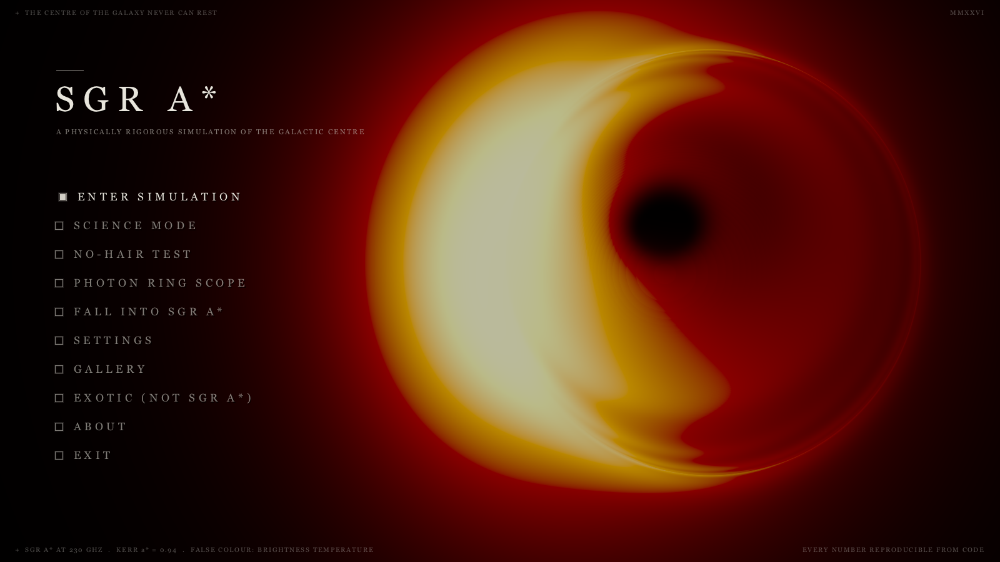

*The main menu. The backdrop is Sgr A\*'s hot accretion flow at 230 GHz — the
band the Event Horizon Telescope observes — rendered by this engine (spin
a\* = 0.94, seen at 30°; false colour = brightness temperature).*

<br>

**[1. What is this?](#1-what-is-this)** ·
**[2. Quick start](#2-quick-start)** ·
**[3. The modes](#3-the-modes)** ·
**[4. The science](#4-the-science)** ·
**[5. The thesis and papers](#5-the-thesis-the-papers-and-how-to-use-them)**

</div>

---

## 1. What is this?

**SGR A\* Scientific Simulator** is a black-hole simulation built to be used as
**research code**: a program and a set of tools that are as mathematically
close to the real Sagittarius A\* as current physics and data allow. It is
also a real-time, interactive visualiser, but the pictures are a consequence
of the physics, never the other way round.

### Why this project exists

Most black-hole renderers, including the ones that inspired this one, are
built to *look* right. This one is built to *be* right, for one specific,
real object:

- **One spacetime: Sgr A\*'s.** Every scene uses the measured mass and
  distance, M = 4.297 ± 0.012 × 10⁶ M☉ and d = 8277 ± 9 pc (GRAVITY 2022),
  with a working spin a\* = 0.94 (Sgr A\*'s spin is not yet measured; every
  tool takes any value). There are no fictional "movie" presets.
- **Exact general relativity.** Light and stars follow exact Kerr geodesics:
  Carter's separated equations in Boyer–Lindquist coordinates, and a
  Hamiltonian tracer in Kerr–Schild coordinates that crosses horizons. No
  pseudo-Newtonian potentials, no post-Newtonian orbits near pericentre.
- **Real data.** The orbit of S2 is fitted to its 145 astrometric and 44
  radial-velocity measurements (Gillessen et al. 2017). Images and
  predictions are compared with the EHT (2022, 2024) and GRAVITY (2018–2022)
  results.
- **Tested, not trusted.** Conserved quantities are held to 10⁻⁶ or better,
  the GPU renderer is checked pixel by pixel against a double-precision CPU
  tracer, and 70 automated tests guard the physics.
- **Reproducible.** Every number in the thesis, the paper and the extension
  is a LaTeX macro written by a script from the program's own output.
  `make reproduce` and `make reproduce-ext` regenerate all of them.
- **Honest labels.** Anything display-only (exposure, bloom, tone curve,
  false colour) or hypothetical (a thin disk at Sgr A\*'s real accretion
  rate, the wormhole) is labelled as such, on screen and in the papers.

### What it does

- **Renders Sgr A\* live on the GPU** (Vulkan): the shadow, the lensed photon
  sub-rings, Doppler colour and beaming, and the gravitationally lensed **real
  Milky Way** behind it.
- **Shows the real accretion flow at 230 GHz**, with thermal-synchrotron
  radiative transfer, and its **polarisation**.
- **Puts the camera in anyone's hands**: a static observer, or one
  **orbiting**, **falling**, **hovering** or **riding the star S2**, with the
  time dilation and frame dragging they would measure.
- **Animates the hot-spot flares** GRAVITY saw in 2018, with light-travel
  delays and photon-ring echoes.
- **Lets you fall into Sgr A\*** on a real free-fall trajectory, through the
  event horizon, with your proper time, the tidal forces and the blueshifted
  sky on the HUD.
- **Fits the S2 orbit** in full GR (mass, distance, Schwarzschild precession,
  gravitational redshift), fits a 5-star cluster, and runs an MCMC.
- **Tests the no-hair theorem** with a free quadrupole (Hartle–Thorne), and
  **forecasts** what future monitoring can measure.
- **Shows an exotic spacetime**, the wormhole from *Interstellar*, as a
  clearly labelled side demo.

### What's new in this version

The original build (gates G0–G12, the thesis) **measured** the black hole.
The extension (gates G13–G24, a separate 72-page report) makes the simulator
**see** it as a real camera would, and adds new science:

| Gate | What was added | Where to find it |
|---|---|---|
| G13 | **Correct colour.** A redshifted blackbody is a blackbody at g·T, so one Planck → CIE → sRGB table gives exact Doppler colour. This also fixed a live-renderer bug that applied the brightness weighting twice. | everywhere · extension ch. 2 |
| G14 | **HDR pipeline** (bloom, AgX and ACES filmic tone curves, progressive anti-aliasing) and **five Sgr A\* presets**, including a *hypothetical* thin disk at Sgr A\*'s measured accretion rate. | keys **1–5** · `--preset` |
| G15 | **The real Milky Way** (NASA SVS *Deep Star Maps 2020*, built from Gaia DR2), gravitationally lensed. | *real Milky Way* checkbox |
| G16 | **Kerr–Schild Hamiltonian integrator** with an analytic gradient: crosses horizons, and the polar "zipper" seam of the old kernel is gone. | the live kernel · ch. 3 |
| G17 | **Moving observers** (ZAMO, orbiting, falling, hovering, riding an S-star) with aberration, Doppler shift and time-dilation readouts. | *observer* menu · `--observer` |
| G18 | **Hot-spot flares** on GRAVITY's 2018 orbit, with slow light, light curves and photon-ring echoes. | *hot spot* panel · `--flare` |
| G19 | **The hot flow at 230 GHz** (semi-analytic RIAF, thermal synchrotron, normalised to the measured 2.4 Jy) and a 2.2 µm near-infrared band. | *band* menu · `--band 230` |
| G20 | **Polarisation**, transported with the Walker–Penrose constant; EVPA maps compared with the EHT 2024 results. | extension ch. 6 |
| G21 | **Exotic demo**: the *Interstellar* (Dneg) wormhole, labelled "not Sgr A\*". | menu **EXOTIC** · `--wormhole` |
| G22 | **Forecasts**: Fisher matrices checked against profile likelihoods; the bias from unmodelled extended mass; when frame dragging in S2's orbit becomes detectable. | extension ch. 7 · no-hair panel |
| G23 | **The extension paper** (72 pages) with its own `make reproduce-ext` pipeline. | [`extension.pdf`](paper/extension/extension.pdf) |
| G24 | **Fall into Sgr A\***: a free-fall worldline through the event horizon, with proper time, tides and the view inside. | menu **FALL INTO SGR A\*** · `--flight` |

Also new: an **image-handedness correction**. The camera now traces the
photon it *receives*, which un-mirrors every Kerr image (thesis Appendix E).
And a **new menu**: the 230 GHz backdrop, a captioned 12-image gallery, the new
forecasts in the no-hair panel, and links to all three documents.

### Headline results

**Measured** (thesis):

| Quantity | This code | Published |
|---|---|---|
| Mass, from S2 alone | **4.270 ± 0.195 × 10⁶ M☉** (0.14σ from GRAVITY) | 4.297 ± 0.012 × 10⁶ M☉ (GRAVITY 2022) |
| Distance, from S2 alone | **8272 ± 182 pc** | 8277 ± 9 pc (GRAVITY 2022) |
| Mass, 5-star joint fit | **4.461 ± 0.119 × 10⁶ M☉** (error 39 % smaller) | — |
| S2 fit quality | χ²/dof = 307.8 / 321 = **0.959** | — |
| Photon-ring diameter (a\* = 0.94, i = 30°) | **49.68 µas** | 51.8 ± 2.3 µas (EHT 2022) |
| Shadow diameter (a\* = 0.94, reference view) | **48.91 µas** | 48.7 ± 7 µas (EHT 2022) |
| S2 gravitational-redshift excess | **205 km/s at 2018.379** | ≈ 200 km/s (GRAVITY 2018) |
| Schwarzschild precession of S2 | **11.98′ per orbit** | detected (GRAVITY 2020) |
| No-hair quadrupole, 95 % interval | **\|ε_q\| < 1.33 × 10⁵** | consistent with Kerr |

**Predicted and found** (extension):

| Topic | Result |
|---|---|
| Thin disk at Sgr A\*'s real accretion rate (2 × 10⁻⁹ – 2 × 10⁻⁷ M☉/yr) | would peak at **7 280 – 23 000 K** and shine **12 – 1 200 ×** brighter than Sgr A\* actually does, so its real flow cannot be a thin disk |
| Live GPU colour vs the fp64 CPU tracer | median luminance difference **0.000**; Doppler contrast within **0.26 %** |
| Observers in motion | shadow edges match Synge's formula plus aberration to **2 × 10⁻¹²**; GPU within **0.72 px** |
| GRAVITY 2018 flare (R = 7 M) | period **43.1 min** (observed 40 ± 8 min), clockwise as observed, but a centroid chord of only **64 µas** in 30 min against ~120 µas observed. This independently reproduces the tension GRAVITY reported. Photon-ring echoes arrive **5.9 – 9.1 min** later |
| The hot flow at 230 GHz (normalised to 2.4 Jy) | ring **42.8 µas**, first visibility null **3.90 Gλ**: smaller than the EHT's 51.8 µas and 3.0 Gλ, so the emission must sit further out |
| Its polarisation | a toroidal field gives a radial pattern, which the EHT excludes; only a vertical field gives the observed spiral (∠β₂ = −135°) |
| No-hair forecast | ten more S2 orbits give σ(ε_q) = **577**, not the naive 34 000, because ε_q acts through a *secular* precession |
| Hidden extended mass | at GRAVITY's present bound it becomes a **5.0σ** false no-hair signal after 32 years, invisible in the χ². Fitting it costs only a factor **1.23** |
| Frame dragging in S2's orbit | needs **34 years** of 10 µas astrometry for a 3σ detection |
| Falling from 30 M | horizon after **27.0 min** of proper time; the end of the model, just above the inner horizon, **8.5 s** later; tidal stretch at the horizon **3.7 × 10⁻³ m/s²** across a 2 m body; conserved quantities kept to **3 × 10⁻¹³** |

---

## 2. Quick start

### Run it

**Double-click `LAUNCH.bat`.** It points Vulkan at the validation layers,
builds the engine the first time (vcpkg compiles the dependencies once, which
takes a while), and opens the main menu. Any arguments go straight to the
engine:

```bat
LAUNCH.bat --validation                     :: Vulkan validation layers on
LAUNCH.bat --shader disk --hud --preset 1   :: skip the menu: the Earth view
LAUNCH.bat --shader disk --hud --band 230   :: the EHT's radio band
LAUNCH.bat --shader disk --hud --flight     :: fall into Sgr A*
LAUNCH.bat --shader disk --hud --wormhole   :: exotic demo (not Sgr A*)
```

**Requirements:** Windows 10/11; a GPU with Vulkan 1.2; Visual Studio 2022
Build Tools (C++); [vcpkg](https://github.com/microsoft/vcpkg) at `C:\vcpkg`;
CMake ≥ 3.25 (Ninja comes through vcpkg). For figures and data: Python 3.11
with NumPy, Matplotlib, Pillow, emcee and OpenCV. For the documents: TinyTeX
(or any TeX Live) and GNU make.

<details>
<summary><b>Build by hand and run the tests</b></summary>

```bat
:: physics core + validation tools
scripts\vcenv.cmd cmake --preset core-rel
scripts\vcenv.cmd cmake --build --preset core-rel

:: + science modules (orbit fitter, forecasts, flares, RIAF, wormhole)
scripts\vcenv.cmd cmake --preset sci-rel
scripts\vcenv.cmd cmake --build --preset sci-rel

:: + the Vulkan engine
scripts\vcenv.cmd cmake --preset engine-rel
scripts\vcenv.cmd cmake --build --preset engine-rel

:: the test suite (70 tests)
scripts\vcenv.cmd ctest --preset sci-rel

:: start at the menu
build\engine-rel\engine\sgr_engine.exe --menu
```

`scripts\vcenv.cmd` loads the MSVC environment and runs the command inside it.
With `--validation`, the engine's exit code is the number of Vulkan
validation errors (every gate requires zero). Set
`VK_LAYER_PATH=C:\vcpkg\installed\x64-windows\bin` first, as `LAUNCH.bat`
does.

</details>

<details>
<summary><b>The real Milky Way background (optional, ~160 MB download)</b></summary>

The lensed sky is NASA SVS *Deep Star Maps 2020* in galactic coordinates
(<https://svs.gsfc.nasa.gov/4851/>). It is too large for git. Save the 8K
galactic EXR as `data/sky/starmap_2020_8k_gal.exr`, then run:

```bat
py -3.11 scripts\prepare_sky.py
```

This writes `engine/assets/sky/starmap_gal_8k.sky` (linear radiance with a
full mip chain). Without it, the engine falls back to procedural stars.
Credit: NASA/Goddard Space Flight Center Scientific Visualization Studio;
Gaia DR2: ESA/Gaia/DPAC. It is the sky as seen from Earth, used as a distant
backdrop, not the sky as seen from the Galactic Centre.

</details>

### Try the new things

| To see… | In the app | From the command line |
|---|---|---|
| Sgr A\* as we see it from Earth (i = 30°) | key **2** | `--shader disk --hud --preset 1` |
| The real flow at 230 GHz (what the EHT imaged) | *Band* → 230 GHz | `--band 230` |
| A near-infrared flare (GRAVITY 2018) | *Band* → 2.2 µm; *Flare* panel → tick *hot spot*, press *play* | `--band kband --flare` |
| The world through a moving observer's eyes | *Observer* menu | `--observer orbit` · `infall` · `hover` · `ride` |
| Light that passed through the ergoregion | *light that visited the ergoregion* | `--ergo` |
| Pure g⁴ beaming, without colour | *bolometric view (gT)⁴* | `--bolometric` |
| The lensed Milky Way alone | untick *thin disk* | `--no-disk` |
| The S-stars on their GR orbits | *S-stars in view*, then *fly out* | `--stars` · `--focus S2 --ride` |
| A fall into Sgr A\* | menu **FALL INTO SGR A\*** | `--flight` (`--flight-r0 30 --flight-theta 60 --flight-rest`) |
| The *Interstellar* wormhole | menu **EXOTIC (NOT SGR A\*)** | `--wormhole --wh-l 6` |
| The exact, science-grade display | *tone curve* → linear | `--display linear` |
| A 4K render for a poster | — | `--offscreen --width 3840 --height 2160 --spp 32 --screenshot out.png` |

<details>
<summary><b>All command-line flags</b></summary>

```
Start-up
  --menu                    boot to the menu (default with no arguments)
  --shader disk --hud       skip the menu, start the live renderer
  --science                 open the Science Mode window at start-up
  --panel NAME              open a menu panel at boot (about|nohair|scope|gallery|settings)
  --validation              Vulkan validation layers on (exit code = error count)

Physics and camera
  --preset N                preset 0-4 (keys 1-5 in the app)
  --astar X  --incl DEG     spin and inclination
  --rcam R   --fov RAD      camera radius [M] and field of view
  --rout R                  outer disk radius [M]
  --tpeak K                 override the disk's peak temperature
  --observer TYPE           orbit | infall | hover | ride (default: static ZAMO)
  --band B                  visible | 230 | kband
  --no-disk                 hide the disk (lensed sky only)
  --ergo                    tint light that passed through the ergoregion
  --max-steps N             ray step budget (default 6000)

Display (never enters a measurement)
  --display OP              linear | agx | aces (default agx; science forces linear)
  --exposure EV  --bloom X  --sky EV
  --bolometric              grey (gT)^4 view of the disk
  --turb X                  display filament/cloud layer, 0-1
  --grid                    10-degree celestial grid
  --blacksky                hide the background
  --procedural-sky          ignore the Milky Way map
  --scale S                 render-resolution scale
  --aim X Y                 place the hole at this screen point (composition)
  --diagnostic              diagnostic shading (CPU/GPU comparison)

S-stars
  --stars  --nopaths        draw the S-stars (without their orbit ellipses)
  --starscale N             pull the orbits in by N (1 = true distance)
  --focus NAME  --ride      lock the camera to a star / ride it
  --epoch YEAR              freeze the star clock at this epoch
  --rot X                   disk rotation in multiples of real time

Flares
  --flare                   hot spot on (R = 7 M, GRAVITY 2018)
  --flare-r R  --flare-t T  orbit radius [M] and observing time [M]
  --flare-amp X             display brightness of the spot
  --movie N --movie-dt DT   offscreen: N frames, DT [M] apart

Falling in
  --flight                  start the fall
  --flight-r0 R             start radius [M] (default 30)
  --flight-theta DEG        start polar angle (default 60)
  --flight-rest             start at rest (default: falling from rest at infinity)
  --look DIR                ahead | back | side
  --flight-frames N         offscreen: record the fall as N frames
  --flight-r R              offscreen: one frame where the faller passes r

Exotic
  --wormhole  --wh-l L      wormhole demo; camera position along the tunnel

Output
  --width W --height H      window or image size
  --offscreen               render exactly W x H in safe row bands, save, exit
  --spp N                   offscreen: progressive samples per pixel
  --frames N                exit after N frames
  --screenshot FILE.png     save the last frame
  --no-mouse                ignore mouse input (repeatable screenshots)
```

</details>

---

## 3. The modes

Navigate the menu with **↑/↓ + Enter** or the mouse. **Esc** returns to the
menu.

| Menu item | What it does |
|---|---|
| **ENTER SIMULATION** | The live renderer. Every control is in the side panel (below): physics, display, observer, band, hot spot, S-stars. |
| **SCIENCE MODE** | The fitted S2 orbit over the real Gillessen et al. (2017) astrometry with the fit summary (M, R₀, χ²/dof), plus a **3D S-star orbit theatre**: S2, S1, S8, S12 and S13 on their integrated GR orbits, coloured by line-of-sight redshift. Drag to rotate, wheel to zoom, double-click for the view from Earth. |
| **NO-HAIR TEST** | The Hartle–Thorne quadrupole slider ε_q, with the extra S2 precession it predicts beside the 95 % interval from the data, and the extension's **forecasts**: σ(ε_q) after ten more orbits (Fisher vs the naive 1/√N), after 32 years of GRAVITY-quality data, and the false signal an unmodelled extended mass would create. |
| **PHOTON RING SCOPE** | Measured sub-ring flux ratios (n = 0/1/2) and a narrow-field live camera on the n = 1 ring at the shadow edge. |
| **FALL INTO SGR A\*** | A free fall from outside the black hole through the event horizon (see below). |
| **SETTINGS** | The control panel, from the menu. |
| **GALLERY** | Twelve renders from this code, each captioned: the lensed Milky Way, 230 GHz views, a hot spot, the ergoregion, the fall, the CPU reference shadow, the n = 1 sub-ring and the wormhole. |
| **EXOTIC (NOT SGR A\*)** | The *Interstellar* wormhole, clearly labelled as not a model of Sgr A\*. |
| **ABOUT** | Sgr A\*'s measured properties with their sources, what the backdrop shows, and the three documents. |
| **EXIT** | Quit. |

<div align="center">
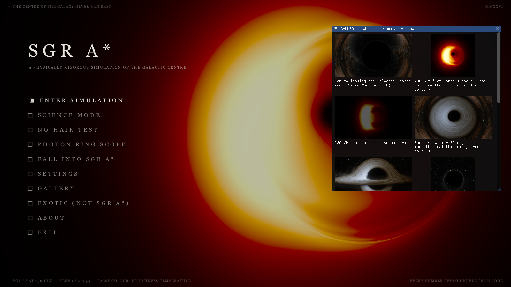
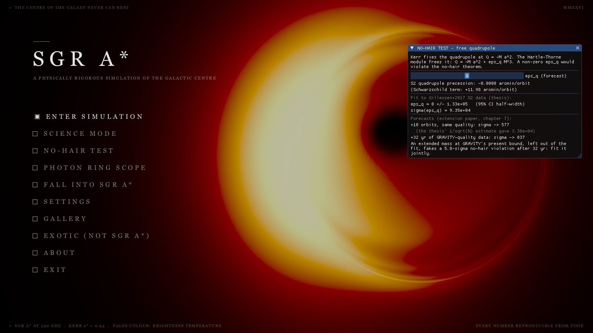
</div>

### The live simulation

<div align="center">
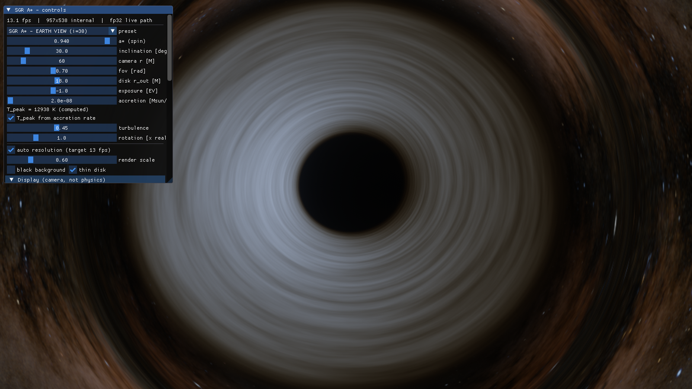
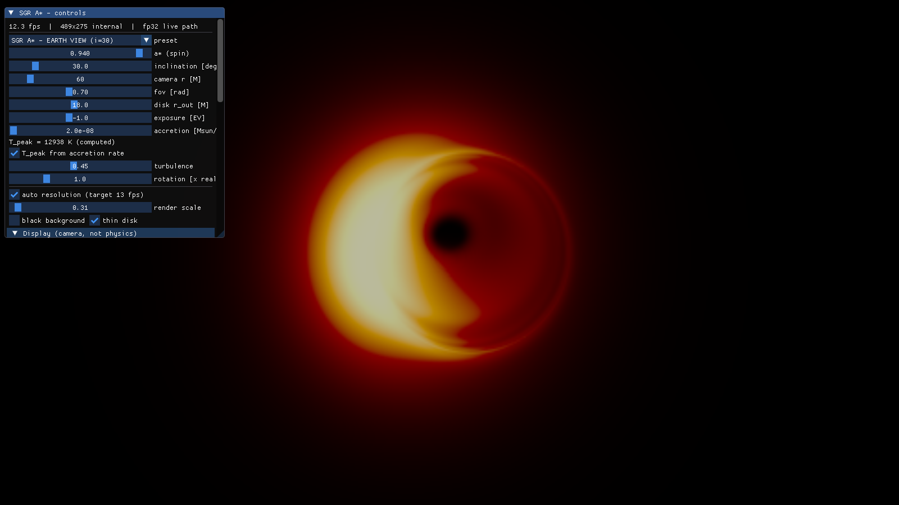
</div>

<div align="center">

*Left: the Earth-view preset (i = 30°) in visible light, with the hypothetical
thin disk. Right: the same black hole at 230 GHz, the real hot flow.*

</div>

**Mouse:** drag to orbit the black hole (full 360°, above and below the disk
plane); scroll to zoom. **Keys 1–5** switch presets. The side panel has:

- **Scene** (top of the panel): preset, spin a\*, inclination, camera
  radius, field of view, disk size, exposure, accretion rate (which sets the
  disk's peak temperature through the Page–Thorne flux) with an optional
  temperature override, rotation speed, resolution, a black background, and
  the thin disk on or off.
- **Display (camera, not physics):** tone curve (linear, AgX, ACES), bloom,
  white balance, saturation, progressive anti-aliasing, sky brightness, the
  real Milky Way and a celestial grid. *Linear* is the exact transform the
  CPU reference uses; Science Mode forces it.
- **Observer – whose eyes:** who holds the camera, with live readouts of their speed
  relative to the local ZAMO, the Lorentz factor, the clock rate dτ/dt, the
  lapse α, the frame-dragging rate ω (and one ZAMO revolution in hours), the
  key radii, and the time dilation of a circular orbit at that radius.
- **Band – what kind of camera:** visible, 230 GHz or 2.2 µm (below).
- **Flare – orbiting hot spot (GRAVITY 2018):** orbit radius, size, spectral
  index, brightness, time warp, play.
- **S-stars:** S2, S1, S8, S12 and S13 drawn *in the scene* at true scale
  (S2 really is ~24 000 M out; *fly out* to see the real proportions). A
  `scale 1:N` slider pulls the orbits in, labelled *hypothetical*, and
  re-integrates them; push it far enough and a star crosses its tidal radius
  and breaks up into a debris stream (Rees 1988), at thresholds predicted from
  each star's measured mass and surface gravity (Habibi et al. 2017).

**Presets.** All five use Sgr A\*'s spin and mass. The visible-light disk is
*hypothetical*: Sgr A\*'s real flow is not a thin disk (see the 230 GHz band).

| Key | `--preset` | Preset | What it shows |
|---|---|---|---|
| 1 | 0 | **SGR A\* – PHYSICAL** | The exact model annulus, no display layers, i = 80°, Ṁ = 2 × 10⁻⁸ M☉/yr |
| 2 | 1 | **SGR A\* – EARTH VIEW (i = 30°)** | Our actual viewing angle, the geometry of the EHT image |
| 3 | 2 | **SGR A\* – CLOSE ORBIT** | A cinematic camera at 45 M with a display cloud layer |
| 4 | 3 | **SGR A\* – LOW ṀDOT (2 × 10⁻⁹)** | The cool end of the measured accretion range (peak 7 280 K) |
| 5 | 4 | **SGR A\* – HIGH ṀDOT (2 × 10⁻⁷)** | The hot end (peak 23 000 K) |

**Bands.**

| Band | What it traces |
|---|---|
| **Visible** | The hypothetical thin disk in true colour: a blackbody at g·T, through the CIE colour-matching functions to sRGB. |
| **230 GHz** | The real hot flow: thermal-synchrotron radiative transfer through a semi-analytic RIAF, normalised to the measured 2.4 Jy. False colour = brightness temperature (1 = 5 × 10¹⁰ K). |
| **2.2 µm** | GRAVITY's near-infrared band: only the flares show (switch the hot spot on). False colour. |

**Observers.**

| Observer | Who that is |
|---|---|
| **Static (ZAMO)** | The default: zero angular momentum, co-rotating with frame dragging. |
| **Orbiting** | Moving at the prograde Keplerian Ω(r). |
| **Falling** | Dropped from rest at infinity (E = 1). |
| **Hovering** | At rest relative to the distant stars. That needs a rocket, and it is impossible inside the ergosphere. |
| **Riding an S-star** | The star's velocity on its full-GR orbit. |

Motion aberrates the sky forward; light ahead is blueshifted and brightened,
light behind is redshifted. Tick *shift the sky by g* to include the
Doppler and gravitational frequency shift of the background.

### Fall into Sgr A\*

<div align="center">
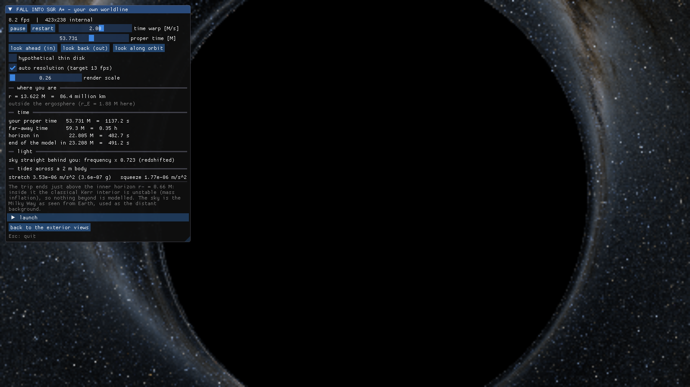
</div>

The camera rides a **real free-fall worldline**: a timelike geodesic,
integrated in double precision in ingoing Kerr–Schild coordinates, which
(unlike Boyer–Lindquist) are regular across the event horizon. By default
it starts at r = 30 M and 60° from the spin axis, falling from rest at
infinity; the *launch* panel sets the start radius (3–300 M), the polar angle
and a start at rest.

- **Controls:** *fall* / *pause*, *restart*, *time warp* (proper time in M per
  second), a *proper time* scrubber, *look ahead (in)*, *look back (out)*,
  *look along orbit*, the hypothetical thin disk on or off, and resolution.
- **HUD, all computed:** radius in M and in km; whether you are outside the
  ergosphere, inside it (you can no longer stay still relative to the stars),
  or inside the horizon; your proper time against far-away time (which stops
  being defined at the horizon); the time left to the horizon and to the end
  of the model; the frequency shift of the sky behind you; and the tidal
  stretch and squeeze across a 2 m body, from the Riemann tensor in your own
  frame.
- **Honesty:** the trip stops just above the inner (Cauchy) horizon,
  r₋ = 0.66 M. Beyond it, mass inflation makes the classical Kerr interior
  unreliable. The screen says so; it does not render it.

### Exotic: the *Interstellar* wormhole

<div align="center">
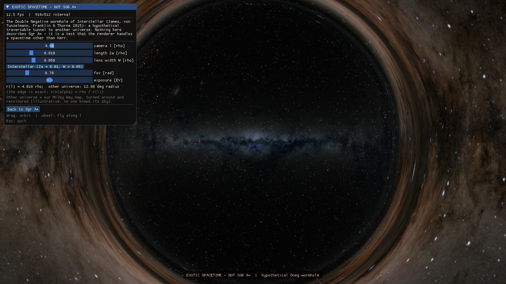
</div>

The Double Negative wormhole of James, von Tunzelmann, Franklin & Thorne
(2015), rendered by the same machinery to test its generality on a non-Kerr
metric. **It is not a model of Sgr A\*** and is labelled so on screen. Drag to
orbit; the wheel flies you along the tunnel. Sliders set the camera position
ℓ, the tunnel length 2a and the lensing width W, and one button restores the
film's values (2a = 0.01ρ, W = 0.05ρ). The readout gives the angular radius of
the other universe, which is exact: sin α = ρ / r(ℓ). The "other universe"
is our own Milky Way map, turned around.

---

## 4. The science

Everything below runs in **two independent paths**. The *science path* is the
double-precision CPU code (Carter/Mino geodesics in Boyer–Lindquist
coordinates, the orbit fitter, the radiative transfer). The *live path* is the
GPU renderer (Kerr–Schild Hamiltonian, single precision). Every live feature is
validated against the science path, and display processing never enters a
measurement.

### 4.1 Spacetime and light rays

- **The Kerr metric** in Boyer–Lindquist coordinates, with exact horizons,
  ergosphere, photon orbits and ISCO. At a\* = 0 every formula reduces to its
  Schwarzschild value exactly, and the tests check it.
- **Null and timelike geodesics** from Carter's constants (E, L_z, Q), using
  second-order equations in Mino time, so turning points need no square roots
  of negative numbers. Health checks hold |ΔE/E|, |ΔL_z/L_z|, |ΔQ/Q| below
  10⁻⁶ and the 4-velocity norm below 10⁻⁸.
- **A Kerr–Schild Hamiltonian tracer** (extension ch. 3) with an analytic
  gradient. It needs no matrix inversion (the inverse metric is closed-form),
  has no polar-axis singularity, and crosses horizons smoothly. On the
  24 handedness test rays it lands within 3 × 10⁻¹¹ of the Carter path (off
  the spin axis) and conserves L_z and Q to 8 × 10⁻¹².
- **Image handedness.** A pixel receives a photon travelling *toward* it.
  Tracing the time-reversed photon is exact in static spacetimes but in Kerr
  traces the spin-reversed spacetime, a mirror image. The error was found,
  corrected throughout and documented (thesis Appendix E): the traced edges
  now sit at Bardeen's prograde (ξ = +2.6415) and retrograde (ξ = −6.8996)
  critical impact parameters to 1.2 × 10⁻¹⁴.

### 4.2 The shadow and the photon ring

- **Shadow metrology** against analytic theory: the Schwarzschild shadow
  matches Synge's formula, and the Kerr shadow is lopsided and lies on
  Bardeen's critical curve. At Sgr A\*'s distance, 1 M subtends 5.1243 µas.
- **Calibration** (a\* = 0.94, i = 30°): photon-ring diameter 49.68 µas,
  against the EHT's 51.8 ± 2.3 µas; 20 × 20 spin–inclination sweep.
- **Photon sub-rings** n = 0, 1, 2, isolated by tracking each ray's
  half-orbits: the n = 0 / n = 1 flux ratio is 10.7 (8.6–16.8 around the
  ring). Each successive ring is demagnified by e^γ, with Lyapunov exponents
  γ = 2.571 (polar) to 3.142 (equatorial) at a\* = 0.94.

<div align="center">
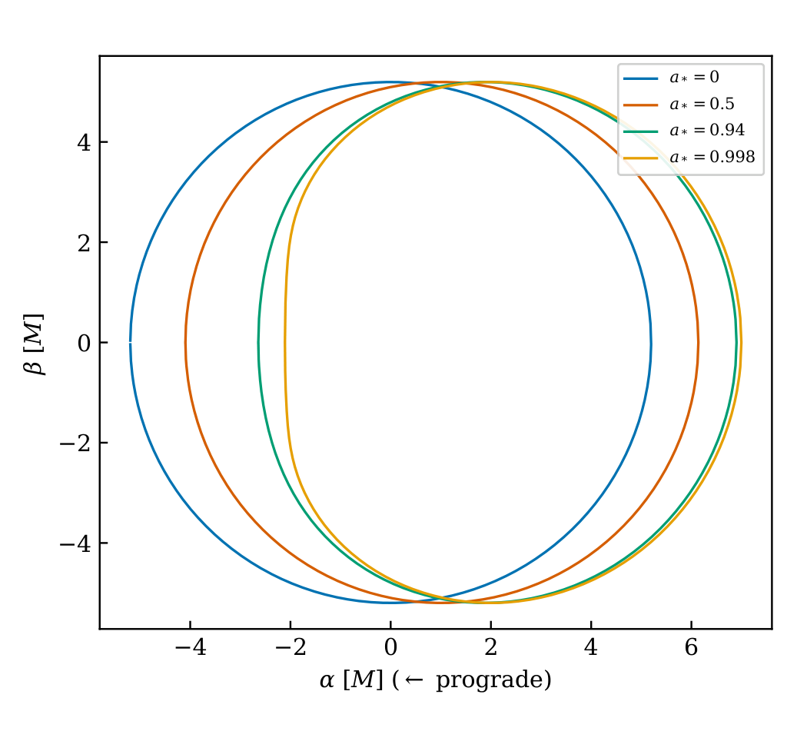
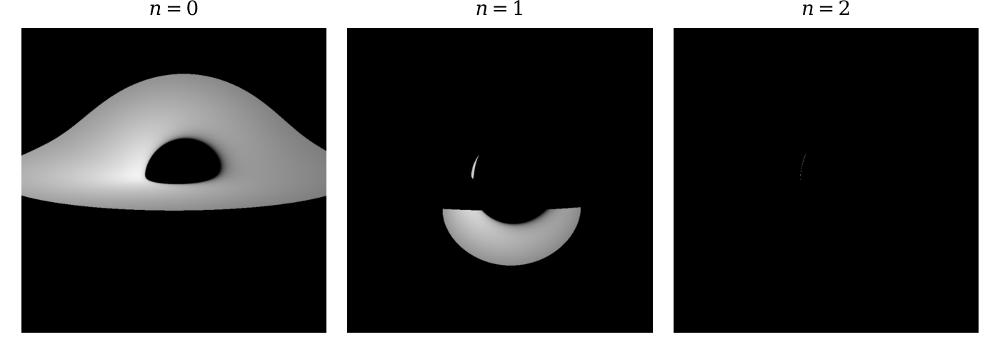
</div>

### 4.3 Light, colour and the (hypothetical) thin disk

- **Novikov–Thorne disk** with the exact Page–Thorne flux, from the ISCO
  outward, with a blackbody at the local effective temperature.
- **Spectral rendering** (extension ch. 2). Because I_ν/ν³ is invariant, a
  blackbody redshifted by g is a blackbody at g·T, so a single
  Planck → CIE XYZ → sRGB table carries both the Doppler colour and the
  beaming. The approaching side is brighter *and* bluer. The live GPU render
  reproduces the fp64 CPU reference: median luminance difference 0.000, 95th
  percentile 2.0 %, Doppler contrast within 0.26 %.
- **A camera is not a bolometer.** The visible-band Doppler contrast differs
  from the bolometric g⁴ law: stronger below ≈ 11 500 K, weaker above.
- **Sgr A\* cannot have a bright thin disk.** Fed at its measured accretion
  rate (2 × 10⁻⁹ – 2 × 10⁻⁷ M☉/yr), such a disk would peak at
  7 280 – 23 000 K and outshine the real Sgr A\* by 12 – 1 200 ×. That is why
  the visible presets are labelled hypothetical and the 230 GHz band exists.

<div align="center">
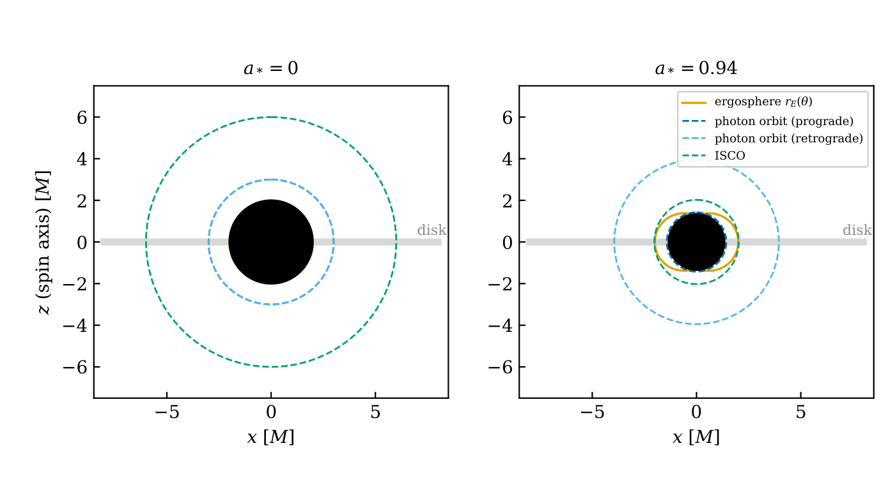
</div>

### 4.4 The S-stars: weighing the black hole

- **Full-GR forward model** of S2: the orbit is a numerically integrated Kerr
  (or Hartle–Thorne) timelike geodesic, so precession, gravitational redshift
  and transverse Doppler shift *emerge* rather than being added. The model
  includes the Rømer light-travel delay and the exact redshift in the ZAMO
  frame.
- **The fit** (Ceres, 13 parameters as in Gillessen et al. 2017): M = 4.270 ±
  0.195 × 10⁶ M☉ and R₀ = 8272 ± 182 pc, with χ²/dof = 0.959. A seeded emcee
  MCMC (32 walkers, 6000 steps) checks the posteriors.
- **Precession:** 11.98′ per orbit (Schwarzschild), −0.204′ (Lense–Thirring).
- **Spectroscopy:** the Brγ line (2.16612 µm) has a GR excess over Newtonian
  Doppler of 205 km/s at the 2018.379 pericentre, as GRAVITY detected.
- **Cluster fit:** S2, S1, S8, S12 and S13 jointly give M = 4.461 ± 0.119 ×
  10⁶ M☉ and R₀ = 8480 ± 81 pc (errors 39 % and 56 % smaller than S2 alone).

<div align="center">
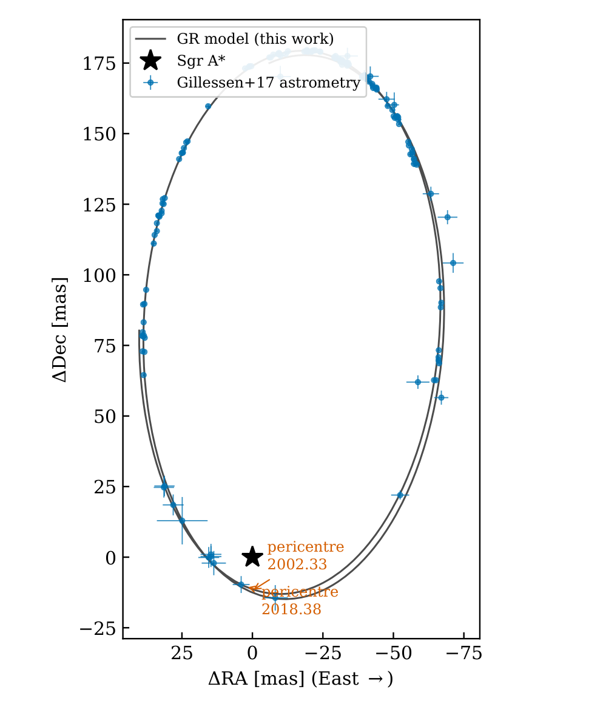
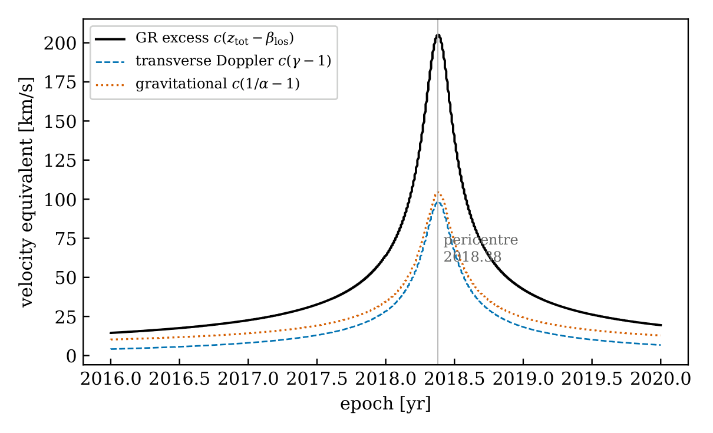
</div>

### 4.5 The no-hair test

In GR a black hole's quadrupole is fixed by its mass and spin, Q = −Ma². The
Hartle–Thorne metric frees it, Q = −Ma² + ε_q M³, and reduces to Kerr at
ε_q = 0 to 10⁻¹² (tested). Fitted to S2, the data give **|ε_q| < 1.33 × 10⁵
(95 %)**: consistent with Kerr, but weak, because the quadrupole's effect falls
as (M/p)² and S2's pericentre is ~1 470 Schwarzschild radii out.

**Forecasts** (extension ch. 7). Fisher matrices from the thesis' own forward
model, checked against its profile likelihood, reproduce its σ(ε_q) = 93 500.
They show that the constraint tightens much faster than 1/√N: ten more orbits of existing
quality give σ(ε_q) = 577, not 34 000. Two cautions follow. An extended mass at
GRAVITY's present bound, left out of the fit, becomes a 5.0σ false no-hair
signal after 32 years, invisible in χ² (fitting it costs only ×1.23). And frame
dragging in S2's orbit needs 34 years of 10 µas astrometry for a 3σ
detection.

<div align="center">
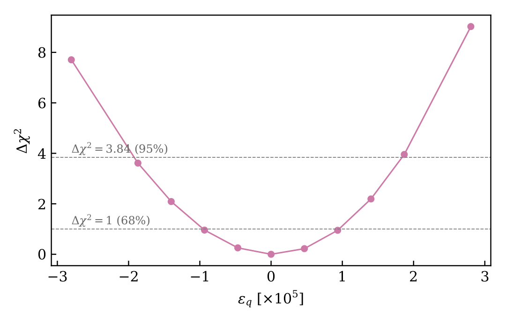
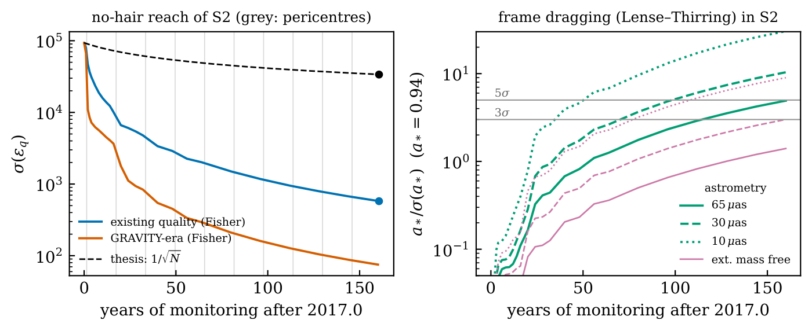
</div>

### 4.6 Observers in motion

Static, orbiting, falling and hovering observers (extension ch. 4) see the sky
through Lorentz-boosted tetrads built on the ZAMO frame. The Schwarzschild
shadow edges match Synge's formula plus special-relativistic aberration to
2 × 10⁻¹². The live renderer matches the fp64 reference to 0.72 px in 14 test
cases. This comparison also exposed, and fixed, a step-budget defect that had
widened the prograde edge of the high-spin shadow by 16.8 px.

### 4.7 Hot-spot flares

A Gaussian hot spot on the orbit GRAVITY fitted to the 2018 near-infrared
flares (R = 7 M, i ≈ 160°), traced with slow light (extension ch. 5). Period
43.1 min (observed 40 ± 8 min), clockwise as observed. But its centroid
moves only 64 µas in 30 minutes against the ~120 µas observed, independently
reproducing the period–loop-size tension GRAVITY reported. Each flash
returns as a photon-ring echo 5.9–9.1 minutes later.

<div align="center">
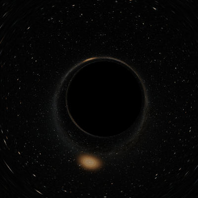
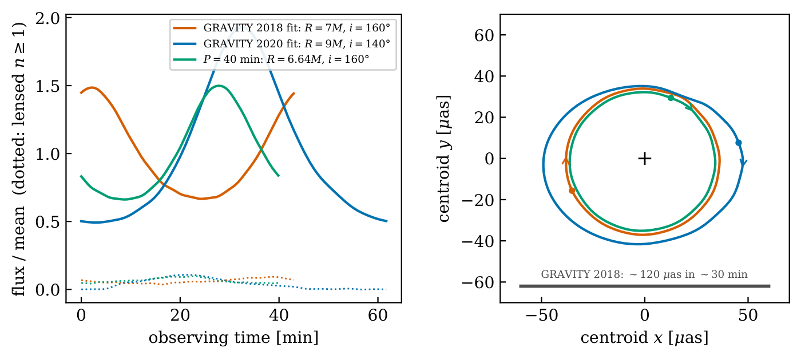
</div>

<div align="center">

*One orbit of the hot spot, rendered by the engine with slow light (false
colour: 2.2 µm light has no visible hue). The background is the lensed Milky
Way seen from Earth.*

</div>

### 4.8 The real accretion flow at 230 GHz, and its polarisation

A semi-analytic radiatively inefficient accretion flow (Broderick & Loeb 2006
profiles; thermal electrons, T₀ = 1.5 × 10¹¹ K, β = 10) is traced with the
thermal-synchrotron emissivity of Leung, Gammie & Noble (2011), with
Kirchhoff absorption, and normalised to the measured 2.4 Jy (extension
ch. 6). Its light sits in a Doppler-boosted crescent *inside* the photon
ring: ring 42.8 µas and first visibility null 3.90 Gλ, smaller than the
EHT's 51.8 µas and 3.0 Gλ. **The emission must sit further out**, for
instance in cooler electrons. Polarisation is carried to the camera with
the Walker–Penrose constant. A toroidal field gives a radial EVPA pattern,
which the EHT excludes; only a vertical (poloidal) field gives the observed
spiral, ∠β₂ = −135° for clockwise rotation.

<div align="center">
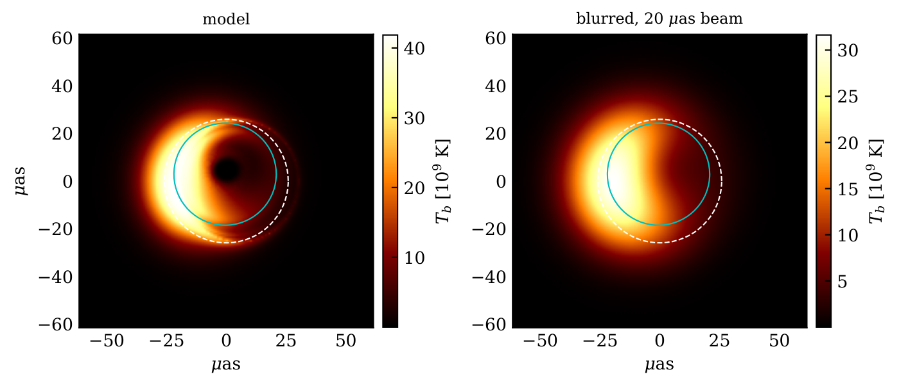
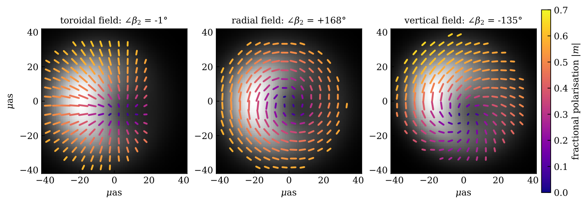
</div>

### 4.9 Falling into Sgr A\*

A timelike geodesic in the ingoing Kerr–Schild chart carries the camera
through the event horizon (extension ch. 8). Its conserved quantities hold to
3 × 10⁻¹³. Two closed-form Schwarzschild falls (from rest; from infinity)
are reproduced to 10⁻¹⁴, and the tidal tensor reproduces the Kretschmann
scalar to 8 × 10⁻⁹. From 30 M, the faller crosses the ergosphere, reaches the
horizon after **27.0 minutes** of proper time (the last 9.6 s from the
ergosphere), and reaches the end of the model **8.5 s** later. The tidal
stretch across a 2 m body is only 3.7 × 10⁻³ m/s² at the horizon, because
tides scale as M/r³ and Sgr A\* is massive. Ahead, the sky skimming the dark
region is blueshifted up to 27.3-fold. The live view matches the fp64 tracer
to 0.73 px, inside the horizon as well as outside.

<div align="center">
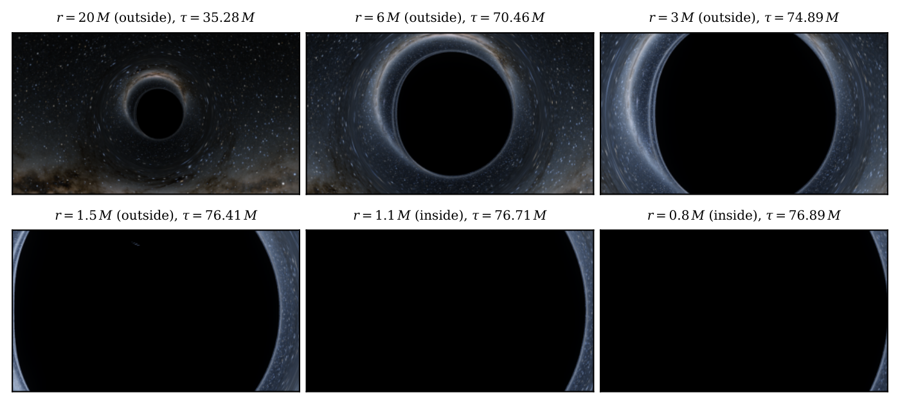
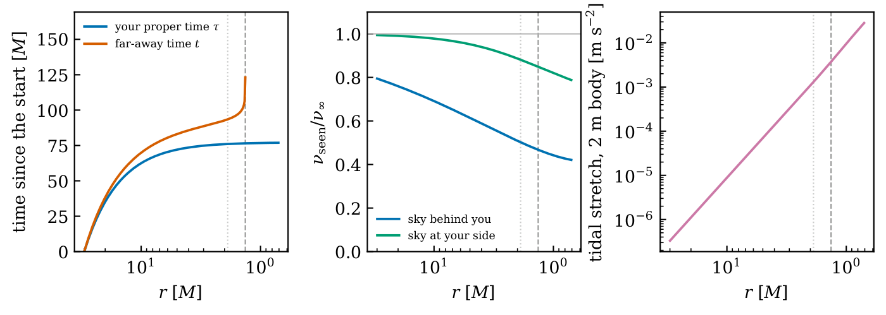
</div>

### 4.10 An exotic spacetime (appendix)

The *Interstellar* wormhole (Dneg) runs through the same camera and sky code.
Its conserved impact parameter holds to 4 × 10⁻¹⁶, the edge of the other
universe matches sin α = ρ / r(ℓ) to 7 × 10⁻¹², and the GPU matches the CPU
to 0.28 px.

<div align="center">
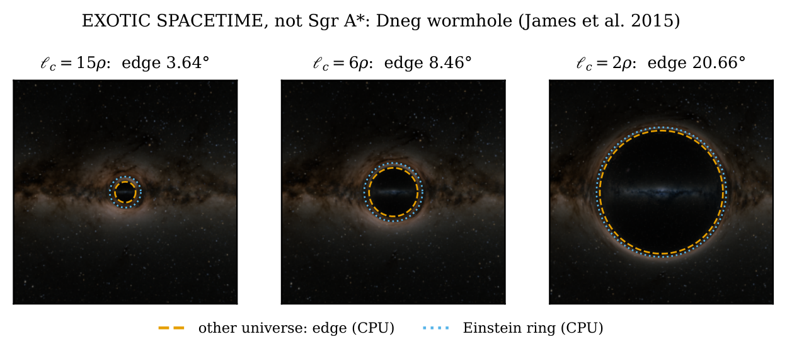
</div>

### 4.11 Validation and the instruments

- **70 tests** (Catch2, run by CTest): the Schwarzschild limit, key radii,
  conservation for null and timelike geodesics, the Hartle–Thorne → Kerr
  limit, Kerr–Schild vs Carter, observers, in-fall, flares, RIAF and
  polarisation, and the wormhole.
- **GPU vs CPU** for every live feature, at the pixel level.
- **Zero Vulkan validation errors** at every gate.

The command-line instruments (in `build\sci-rel\…`) write JSON that the
documents read:

| Tool | Purpose |
|---|---|
| `validation\render_reference.exe` | CPU fp64 reference renders + shadow metrology |
| `validation\render_disk_cpu.exe` | CPU reference render of the disk |
| `validation\compare_shadow.exe` | GPU vs CPU comparison |
| `validation\convergence_tool.exe` | integrator convergence |
| `validation\sweep_tool.exe` | Sgr A\* ring calibration; spin–inclination sweep |
| `validation\physics_tables.exe` | the thesis' physics tables |
| `validation\handedness_tool.exe` | the image-handedness checks |
| `validation\spectral_tool.exe` | colour validation; the thin disk at the real Ṁ (G13–G14) |
| `validation\observer_tool.exe` | observers and aberration (G17) |
| `validation\infall_tool.exe` | the fall into Sgr A\* (G24) |
| `science\subring_tool.exe` | Doppler beaming and photon sub-ring isolation |
| `science\orbit_fitter\fit_s2_tool.exe` | the S2 fit, `kerr` or `nohair` (free ε_q) |
| `science\orbit_fitter\fit_cluster.exe` | the 5-star joint fit |
| `science\orbit_fitter\forecast_tool.exe` | Fisher forecasts, profiles, biases (G22) |
| `science\flare_tool.exe` | hot-spot flares (G18) |
| `science\riaf_tool.exe` | the 230 GHz flow and polarisation (G19–G20) |
| `science\wormhole_tool.exe` | the exotic demo (G21) |

### 4.12 Limits, stated

The visible-light disk is hypothetical. The RIAF is semi-analytic (no GRMHD),
with thermal electrons only, and omits Faraday effects. The background sky is
the Earth-view panorama. The interior beyond the inner horizon is not modelled.
The ε_q constraint from S2 is far from interesting values. Each limit is
discussed in the documents.

---

## 5. The thesis, the papers, and how to use them

| Document | Pages | What it is |
|---|---|---|
| [**`paper/thesis.pdf`**](paper/thesis.pdf) | 210 | The full report: six primers for readers with no relativity background, then the theory, methods, results, engineering and the validation record. |
| [**`paper/main.pdf`**](paper/main.pdf) | 11 | The journal-shaped version (MNRAS style): theory, methods and all results, with appendices on verification gates, reproduction and number provenance. |
| [**`paper/extension/extension.pdf`**](paper/extension/extension.pdf) | 72 | The companion report for G13–G24: spectral rendering, the Kerr–Schild integrator, observers, flares, the 230 GHz flow and polarisation, forecasts, and the fall into Sgr A\*. Deliberately separate from the thesis. |

**The thesis, part by part.**

| Part | Chapters | Content |
|---|---|---|
| **I – Foundations for the non-specialist** | 1–6 | Gravity; spacetime; spin and the shadow; light and colour; orbits and weighing a black hole; the numerical toolkit, in plain words |
| **II – Theory and methods** | 7–10 | Strong-field context; Kerr geometry from first principles; geodesics and the Carter constant; numerical methods and error analysis |
| **III – Results** | 11–17 | The reference tracer and shadow; the Novikov–Thorne disk; photon-ring substructure; the S-star forward model; the S2 fit; the 5-star cluster; the no-hair test |
| **IV – Engineering, validation, closing** | 18–23 | The GPU port and its validation; Sgr A\* calibration; the interactive instrument; development history and the test suite; discussion; conclusions |
| **Appendices** | A–F | Extended algebra; pseudocode; number provenance; the reproduction pipeline; image handedness (an error found and corrected); notation |

**The extension, chapter by chapter:** 1 Introduction · 2 Spectral rendering:
what a camera sees · 3 A horizon-penetrating integrator · 4 Whose eyes?
Observers in motion · 5 Orbiting hot spots: the GRAVITY flares · 6 The hot
accretion flow at 230 GHz · 7 Forecasts for orbit monitoring · 8 Falling into
Sagittarius A\* · 9 Discussion and limitations · 10 Conclusions · Appendix A
The traversable wormhole · Appendix B Reproducing this report.

**Build them:**

```bash
make figures         # all thesis/paper figures from simulation output
make paper           # paper/main.pdf
make thesis          # paper/thesis.pdf
make reproduce       # re-run the whole thesis chain: tests, renders, fits, figures, numbers
make reproduce-ext   # the same for the extension (all G13-G24 tools and comparisons)
make extension       # paper/extension/extension.pdf
```

Every quantity in the three documents is a LaTeX macro (`numbers.tex`,
`numbers_ext.tex`) generated from the tools' JSON output, so the prose cannot
drift from the code.

### 5.1 Using it for study and visualisation

**To learn general relativity by seeing it.** Read thesis Part I (no GR
background assumed), then open the simulator and switch one effect at a time:

| Try this | You will see | Read |
|---|---|---|
| Set a\* = 0, then raise it | the shadow goes from a circle to a lopsided D; the prograde photon orbit moves in | thesis ch. 3, 8 |
| *bolometric view (gT)⁴*, then visible | g⁴ beaming alone, then what a real camera records | extension ch. 2 |
| Observer: static → orbiting → falling | aberration, the Doppler "searchlight", time dilation in the HUD | extension ch. 4 |
| *light that visited the ergoregion* | the frame-dragged crescent of light that escaped from inside r_E | thesis ch. 3 |
| S-stars, `scale 1:N` | Kepler's third law, the GR rosette, and tidal disruption at predicted thresholds | thesis ch. 5, 14 |
| Band: visible → 230 GHz | why the EHT image is not a thin disk | extension ch. 6 |
| FALL INTO SGR A\* | proper time against far-away time, gentle tides at a supermassive horizon, the sky blueshifting ahead | extension ch. 8 |

**To teach or present.** Every image comes from a documented command
(`--offscreen … --spp 32 --screenshot`), at any resolution, so slides and
posters are reproducible. The gallery, the flare GIF and the figures in
`docs/images/` are ready to use, and display-only processing is always
labelled.

**For research.** The libraries are reusable on their own:

- `physics/` (`sgr_physics`): Kerr metric, Carter/Mino null and timelike
  geodesics, the Kerr–Schild Hamiltonian, observer tetrads, the in-fall
  worldline and tidal tensor, Hartle–Thorne, the Page–Thorne disk.
- `science/`: the Ceres orbit fitter (any star in the Gillessen et al. 2017
  table, via `scripts/fetch_gillessen_data.py --stars …`), Fisher forecasts and
  profile likelihoods for new instruments or campaign lengths, the RIAF
  radiative transfer and polarisation, hot spots, and sub-ring extraction.

Change a parameter, run the tool, and the JSON, the numbers and the figures
follow: the same pipeline that writes the documents.

### 5.2 Equation summary

Geometric units G = c = 1 unless stated. For Sgr A\*: r_g = GM/c² =
6.35 × 10⁶ km, t_g = GM/c³ = 21.2 s, and 1 M on the sky = 5.1243 µas.

**Kerr metric** (Boyer–Lindquist; a = a\*M = J/M):

```math
ds^2 = -\Bigl(1-\frac{2Mr}{\Sigma}\Bigr)dt^2 - \frac{4Mar\sin^2\theta}{\Sigma}\,dt\,d\phi + \frac{\Sigma}{\Delta}\,dr^2 + \Sigma\,d\theta^2 + \frac{\mathcal{A}\sin^2\theta}{\Sigma}\,d\phi^2
```

```math
\Sigma = r^2 + a^2\cos^2\theta,\qquad \Delta = r^2 - 2Mr + a^2,\qquad \mathcal{A} = (r^2+a^2)^2 - a^2\Delta\sin^2\theta
```

**Horizons, ergosphere, photon orbits, ISCO** (upper sign prograde):

```math
r_\pm = M \pm \sqrt{M^2 - a^2},\qquad r_E(\theta) = M + \sqrt{M^2 - a^2\cos^2\theta},\qquad r_{\rm ph} = 2M\left\{1 + \cos\!\left[\tfrac{2}{3}\arccos\!\left(\mp\frac{a}{M}\right)\right]\right\}
```

```math
r_{\rm ISCO} = M\left[3 + Z_2 \mp \sqrt{(3 - Z_1)(3 + Z_1 + 2Z_2)}\right],\qquad Z_1 = 1 + (1-a_\ast^2)^{1/3}\left[(1+a_\ast)^{1/3} + (1-a_\ast)^{1/3}\right],\qquad Z_2 = \sqrt{3a_\ast^2 + Z_1^2}
```

At a\* = 0 these give 2M, 2M, 3M and 6M. At a\* = 0.94: r₊ = 1.341 M,
r₋ = 0.659 M, r_E = 2 M (equator), r_ph = 1.43 M / 3.95 M,
r_ISCO = 2.024 M.

**ZAMO (locally non-rotating) frame:** frame dragging and lapse

```math
\omega = -\frac{g_{t\phi}}{g_{\phi\phi}} = \frac{2Mar}{\mathcal{A}},\qquad \alpha = \sqrt{\frac{\Sigma\Delta}{\mathcal{A}}},\qquad e_{\hat t} = \frac{1}{\alpha}\bigl(\partial_t + \omega\,\partial_\phi\bigr)
```

**Geodesics** (Carter 1968; μ = 0 light, μ = 1 matter; E = −p_t, L_z = p_φ, Q
Carter's constant):

```math
\Sigma\frac{dr}{d\lambda} = \pm\sqrt{R(r)},\qquad \Sigma\frac{d\theta}{d\lambda} = \pm\sqrt{\Theta(\theta)}
```

```math
\Sigma\frac{d\phi}{d\lambda} = -\Bigl(aE - \frac{L_z}{\sin^2\theta}\Bigr) + \frac{a}{\Delta}P,\qquad \Sigma\frac{dt}{d\lambda} = -a\bigl(aE\sin^2\theta - L_z\bigr) + \frac{r^2+a^2}{\Delta}P
```

```math
P = E(r^2+a^2) - aL_z,\qquad R = P^2 - \Delta\bigl[\mu^2r^2 + (L_z - aE)^2 + Q\bigr],\qquad \Theta = Q - \cos^2\theta\Bigl[a^2(\mu^2 - E^2) + \frac{L_z^2}{\sin^2\theta}\Bigr]
```

In Mino time (dλ = Σ dσ) the motions decouple, and the integrator uses the
second-order form, which passes turning points smoothly:

```math
\frac{d^2r}{d\sigma^2} = \tfrac12R'(r),\qquad \frac{d^2\theta}{d\sigma^2} = \tfrac12\Theta'(\theta),\qquad \frac{|\Delta E|}{|E|},\ \frac{|\Delta L_z|}{|L_z|},\ \frac{|\Delta Q|}{|Q|} < 10^{-6},\qquad \bigl|g_{\mu\nu}u^\mu u^\nu + \mu^2\bigr| < 10^{-8}
```

**Kerr–Schild Hamiltonian tracer** (Cartesian; s = −1 outgoing chart for
camera rays traced backwards, s = +1 ingoing chart for the fall):

```math
g_{\mu\nu} = \eta_{\mu\nu} + f\,l_\mu l_\nu,\qquad g^{\mu\nu} = \eta^{\mu\nu} - f\,l^\mu l^\nu,\qquad f = \frac{2Mr^3}{r^4 + a^2z^2},\qquad r^4 - (x^2+y^2+z^2-a^2)\,r^2 - a^2z^2 = 0
```

```math
l_\mu = \Bigl(1,\ s\frac{rx + s\,ay}{r^2+a^2},\ s\frac{ry - s\,ax}{r^2+a^2},\ s\frac{z}{r}\Bigr),\qquad H = \tfrac12g^{\mu\nu}p_\mu p_\nu,\qquad \frac{dx^\mu}{d\lambda} = g^{\mu\nu}p_\nu,\qquad \frac{dp_i}{d\lambda} = \tfrac12\,\partial_i\bigl[f\,(l\cdot p)^2\bigr]
```

H = 0 for light; H = −½ for a falling observer, so λ is proper time.

**Shadow edge** (Bardeen 1973): spherical photon orbits seen at inclination
θ_o, with ξ = L_z/E and η = Q/E²:

```math
\xi = \frac{r^2(3M - r) - a^2(r + M)}{a(r - M)},\qquad \eta = \frac{r^3\bigl[4a^2M - r(r - 3M)^2\bigr]}{a^2(r - M)^2},\qquad \alpha = -\frac{\xi}{\sin\theta_o},\qquad \beta = \pm\sqrt{\eta + a^2\cos^2\theta_o - \xi^2\cot^2\theta_o}
```

**Moving observers:** Synge's shadow (static, Schwarzschild), aberration,
boosted tetrads, and the frequency an observer measures:

```math
\sin\alpha_{\rm sh} = \frac{3\sqrt3\,M}{r}\sqrt{1 - \frac{2M}{r}},\qquad \cos\theta' = \frac{\cos\theta + v}{1 + v\cos\theta},\qquad \nu_{\rm obs} = -p_\mu u^\mu_{\rm obs}
```

```math
e'_0 = \gamma\bigl(e_{\hat t} + v^je_{\hat j}\bigr),\qquad e'_j = e_{\hat j} + (\gamma - 1)\frac{v_jv^k}{v^2}e_{\hat k} + \gamma v_je_{\hat t},\qquad \frac{d\tau}{dt} = \frac{1}{e_0'^{\,t}}
```

Relative to the ZAMO: orbiting v_φ̂ = (Ω − ω)√g_φφ/α; falling from rest at
infinity v_r̂ = −√(2Mr(r²+a²)/𝒜); hovering v_φ̂ = −ω√g_φφ/α (possible only
where v < 1, outside the ergosphere).

**Redshift, colour and beaming** (circular equatorial emitter, received
photon with ℓ = L_z/E; upper sign prograde):

```math
g = \frac{\nu_{\rm obs}}{\nu_{\rm em}} = \frac{1}{u^t\,(1 - \Omega\,\ell)},\qquad \Omega = \frac{\pm M^{1/2}}{r^{3/2} \pm aM^{1/2}},\qquad u^t = \frac{r^{3/2} \pm aM^{1/2}}{r^{3/4}\sqrt{r^{3/2} - 3Mr^{1/2} \pm 2aM^{1/2}}}
```

```math
\frac{I_\nu}{\nu^3} = \text{invariant}\quad\Rightarrow\quad I_\nu^{\rm obs} = g^3B_{\nu/g}(T) = B_\nu(gT),\qquad I_{\rm bol}^{\rm obs} = g^4\,I_{\rm bol}^{\rm em},\qquad (X,Y,Z) = \int B_\lambda(gT)\,(\bar x,\bar y,\bar z)\,d\lambda \to \text{sRGB}
```

**Thin disk** (Page & Thorne 1974; E, L, Ω of circular orbits; the code uses
the closed form of this integral):

```math
F(r) = -\frac{\dot M}{4\pi r}\,\frac{\partial_r\Omega}{(E - \Omega L)^2}\int_{r_{\rm ISCO}}^{r}(E - \Omega L)\,\partial_{r'}L\,dr',\qquad \sigma_{\rm SB}T_{\rm eff}^4 = F
```

**S-star observables** (sky frame with z pointing away from us; n̂ toward the
observer; p = a(1 − e²); q̃ = Q/M³; the precession formulas are analytic
cross-checks of the integrated orbit):

```math
t_{\rm obs} = t_{\rm em} + \frac{z(t_{\rm em})}{c},\qquad 1 + z = \frac{\gamma\,(1 - \boldsymbol\beta\cdot\hat{\boldsymbol n})}{\alpha},\qquad \lambda_{\rm obs} = 2.16612\ \mu{\rm m}\,(1 + z)
```

```math
\Delta\omega_{\rm S} = \frac{6\pi M}{p},\qquad \Delta\omega_{\rm LT} = -8\pi a_\ast\Bigl(\frac{M}{p}\Bigr)^{3/2},\qquad \Delta\omega_{Q} = -3\pi\,\tilde q\,\Bigl(\frac{M}{p}\Bigr)^2\qquad\text{(per orbit, equatorial)}
```

**No-hair test and extended mass** (Hartle & Thorne 1968; Plummer 1911):

```math
Q = -Ma^2 + \varepsilon_q M^3\quad(\varepsilon_q = 0 \Leftrightarrow \text{Kerr}),\qquad M_{\rm ext}(<r) = M_{\rm ext}\,\frac{r^3}{(r^2 + b^2)^{3/2}}
```

**Statistics:** χ² fits (Ceres), Fisher forecasts and profile likelihoods:

```math
\chi^2 = \sum_k\frac{(d_k - m_k)^2}{\sigma_k^2},\qquad F_{ij} = \sum_k\frac{1}{\sigma_k^2}\frac{\partial m_k}{\partial\theta_i}\frac{\partial m_k}{\partial\theta_j},\qquad \sigma(\theta_i) = \sqrt{(F^{-1})_{ii}},\qquad \Delta\chi^2_{\rm prof}(\varepsilon_q) = 3.84\ \ (95\,\%)
```

**Hot spot** (GRAVITY 2020 model; comoving distance d; spectral index α;
emission time from each ray's own travel time Δt < 0):

```math
j \propto e^{-d^2/2s^2},\qquad d^2 = (g_{\mu\nu} + u_\mu u_\nu)\,\Delta x^\mu\Delta x^\nu,\qquad \Omega = \frac{1}{R^{3/2} + a},\qquad I_{\rm obs} = \int g^{2+\alpha}\,j\,d\lambda,\qquad t_{\rm em} = t_{\rm obs} + \Delta t
```

**Hot accretion flow at 230 GHz** (Broderick & Loeb 2006 flow; Leung,
Gammie & Noble 2011 emissivity; ρ cylindrical radius, Θ_e = kT_e/m_ec²):

```math
n_e = n_0\Bigl(\frac{\rho}{M}\Bigr)^{-1.1}e^{-z^2/2\rho^2},\qquad T_e = T_0\Bigl(\frac{r}{M}\Bigr)^{-0.84},\qquad \frac{B^2}{8\pi} = \frac{1}{\beta}\,\frac{n_em_pc^2\,r_S}{12\,r}
```

```math
j_\nu = \frac{\sqrt2\,\pi e^2n_e\nu_s}{3cK_2(1/\Theta_e)}\bigl(X^{1/2} + 2^{11/12}X^{1/6}\bigr)^2e^{-X^{1/3}},\qquad X = \frac{\nu}{\nu_s},\qquad \nu_s = \frac29\,\frac{eB}{2\pi m_ec}\,\Theta_e^2\sin\theta_B
```

```math
\alpha_\nu = \frac{j_\nu}{B_\nu(T_e)},\qquad \frac{I_{\rm obs}}{\nu_{\rm obs}^3} = \sum_k\frac{B_{\nu_f}(T_e)}{\nu_f^3}\bigl(1 - e^{-\Delta\tau_k}\bigr)e^{-\tau_k}
```

**Polarisation** (Walker & Penrose 1970; f the polarisation vector along the
null ray k; at emission f ∝ ε^{μνρσ}u_ν k_ρ b_σ; β₂ the azimuthal mode of
Palumbo, Wong & Prather 2020):

```math
\kappa = (A - iB)(r - ia\cos\theta),\qquad A = (k^tf^r - k^rf^t) + a\sin^2\theta\,(k^rf^\phi - k^\phi f^r),\qquad B = \bigl[(r^2+a^2)(k^\phi f^\theta - k^\theta f^\phi) - a(k^tf^\theta - k^\theta f^t)\bigr]\sin\theta
```

```math
\beta_2 = \frac{\sum P\,e^{-2i\varphi}}{\sum I}
```

**Falling in:** proper time, tides and curvature (E_ij the tidal tensor in the
faller's frame; B_ij its magnetic part):

```math
\frac{D^2\xi^i}{d\tau^2} = -E^i{}_j\,\xi^j,\qquad E_{ij} = R_{i\alpha j\beta}u^\alpha u^\beta,\qquad K = R_{abcd}R^{abcd} = 8\bigl(E_{ij}E^{ij} - B_{ij}B^{ij}\bigr) = \frac{48M^2(r^2 - a^2\cos^2\theta)\bigl[(r^2 + a^2\cos^2\theta)^2 - 16r^2a^2\cos^2\theta\bigr]}{(r^2 + a^2\cos^2\theta)^6}
```

```math
\text{from rest at } r_0:\ \ \tau = \sqrt{\frac{r_0^3}{8M}}\,(\eta + \sin\eta),\ \ r = \frac{r_0}{2}(1 + \cos\eta);\qquad \text{from rest at infinity:}\ \ \tau = \frac{2}{3}\,\frac{r_0^{3/2} - r^{3/2}}{\sqrt{2M}}\qquad\text{(Schwarzschild checks)}
```

**The Dneg wormhole** (James, von Tunzelmann, Franklin & Thorne 2015; not Sgr
A\*):

```math
ds^2 = -dt^2 + d\ell^2 + r(\ell)^2\bigl(d\theta^2 + \sin^2\theta\,d\phi^2\bigr),\qquad r(\ell) = \begin{cases}\rho, & |\ell| \le a\\[2pt] \rho + \mathcal{M}\bigl[x\arctan x - \tfrac12\ln(1 + x^2)\bigr], & |\ell| > a\end{cases},\qquad x = \frac{2(|\ell| - a)}{\pi\mathcal{M}}
```

```math
\sin\alpha_{\rm edge} = \frac{\rho}{r(\ell)},\qquad W = 1.42953\,\mathcal{M}
```

### 5.3 Tools used to make the tables, graphs, images and papers

| Job | Tools |
|---|---|
| Language and build | C++20 · MSVC (Visual Studio 2022 Build Tools) · CMake presets + Ninja · vcpkg (manifest mode) |
| Physics and science | GLM · Eigen 3 (linear algebra, Fisher matrices) · Ceres Solver (orbit fits) · Catch2 v3 (the 70 tests) · Google Benchmark · spdlog · nlohmann-json (every tool writes JSON) · stb (PNG) |
| Real-time engine | Vulkan 1.2 through volk, vk-bootstrap and the Vulkan Memory Allocator · GLFW · Dear ImGui (menu and HUD) · shaderc (GLSL → SPIR-V) · Khronos validation layers |
| Rendering techniques | dual-filter bloom (Jimenez 2014) · AgX (Sobotka 2022; Wrensch 2023) and ACES-fit (Narkowicz 2016) tone curves · R2 quasi-random sampling (Roberts 2018) · CIE fits of Wyman, Sloan & Shirley (2013) |
| Graphs and tables | Python 3.11 · NumPy · Matplotlib (every graph, one shared style in `scripts/figstyle.py`) · emcee (MCMC) |
| Images and movies | the engine itself, offscreen (`--offscreen --spp N --screenshot`) · the fp64 CPU tracer · Pillow (gallery, contact sheets, the flare GIF) · OpenCV (reading the EXR sky map) |
| Documents | LaTeX (pdfLaTeX from TinyTeX) · BibTeX · the `mnras` class (paper) and `report` class (thesis, extension) · GNU make |
| Data access | VizieR/CDS (catalogue J/ApJ/837/30, via `scripts/fetch_gillessen_data.py`) |

**The pipeline.** Nothing in the documents is typed by hand:

```
C++ tools ─► JSON / CSV ─┬─► make_numbers*.py ─► numbers*.tex (every number), tab_*.tex
                         └─► make_figures*.py ─► every graph
sgr_engine --offscreen ──► render_ext_gallery.py, make_flare_movie.py ─► renders, GIF
make_diagrams.py ────────► the explanatory diagrams of the primers
pdflatex + bibtex ───────► thesis.pdf · main.pdf · extension.pdf
```

| Script | Makes |
|---|---|
| `make_numbers.py`, `make_numbers_ext.py` | every number as a LaTeX macro, and the extension's tables |
| `make_figures.py`, `make_figures_ext.py` | every graph in the three documents |
| `make_diagrams.py` | the explanatory diagrams of thesis Part I |
| `render_ext_gallery.py` | the engine renders used as figures, one documented command each |
| `make_flare_movie.py` | `validation/extension/g18_flare_movie.gif` |
| `run_mcmc.py` | the seeded emcee run |
| `run_bench.py` | the CPU and GPU benchmarks |
| `fetch_gillessen_data.py` | the S-star data from VizieR |
| `prepare_sky.py` | the Milky Way map, packed for the GPU |
| `planck_cie.py` | the Python twin of the Planck → CIE colour function |

### 5.4 Sources and inspiration

**Inspiration**

- **[rossning92/Blackhole](https://github.com/rossning92/Blackhole)**: a
  real-time Schwarzschild black hole in C++, OpenGL and GLSL, ray-marched,
  with Einstein rings. It showed how far a real-time shader can go.
- **[kavan010/black_hole](https://github.com/kavan010/black_hole)**: a C++ and
  OpenGL black-hole simulation with a geodesic compute shader, an accretion
  disk and 2D/3D modes.
- **Alessandro Roussel (ScienceClic)**, who made the black-hole simulations
  for Veritasium's 2024 video
  [*Something Strange Happens When You Follow Einstein's Math*](https://www.veritasium.com/videos/2024/6/19/something-strange-happens-when-you-follow-einsteins-math)
  ([his post](https://x.com/ScienceClic/status/1785229874614915548)). Comparing our
  renders with his Kerr and wormhole visualisations led to the G13–G24
  extension.
- ***Interstellar*** and its science: James, von Tunzelmann, Franklin &
  Thorne (2015), on Gargantua's lensing and on the wormhole. Luminet (1979),
  the first image of a black hole with a thin disk.

**Data**

- **Gillessen et al. (2017)**: S2 and S-star astrometry and radial
  velocities, VizieR J/ApJ/837/30 (`data/gillessen_2017/`).
- **Habibi et al. (2017)**: S-star masses and surface gravities
  (`data/habibi_2017/`).
- **GRAVITY Collaboration (2018, 2020, 2022)** and **Event Horizon Telescope
  Collaboration (2022, 2024)**: the published values everything is compared
  with.
- **NASA SVS *Deep Star Maps 2020***, from Gaia DR2 (ESA/Gaia/DPAC): the sky
  background (<https://svs.gsfc.nasa.gov/4851/>).

**Literature.** All 78 works cited in the thesis, the paper and the extension,
listed from `paper/refs.bib` and `paper/extension/refs_ext.bib`:

<details>
<summary><b>Show the full reference list</b></summary>

- **Bardeen (1973)** — *Timelike and null geodesics in the Kerr metric*. Black Holes (Les Astres Occlus), 215–239.
- **Bardeen, Press & Teukolsky (1972)** — *Rotating Black Holes: Locally Nonrotating Frames, Energy Extraction, and Scalar Synchrotron Radiation*. The Astrophysical Journal 178, 347–370. [doi:10.1086/151796](https://doi.org/10.1086/151796)
- **Blandford & Znajek (1977)** — *Electromagnetic Extraction of Energy from Kerr Black Holes*. Monthly Notices of the Royal Astronomical Society 179, 433-456.
- **Boyer & Lindquist (1967)** — *Maximal Analytic Extension of the Kerr Metric*. Journal of Mathematical Physics 8, 265-281.
- **Broderick & Loeb (2006)** — *Imaging optically-thin hotspots near the black hole horizon of Sgr A\* at radio and near-infrared wavelengths*. Monthly Notices of the Royal Astronomical Society 367, 905–916. [doi:10.1111/j.1365-2966.2006.10152.x](https://doi.org/10.1111/j.1365-2966.2006.10152.x)
- **Broderick et al. (2011)** — *Evidence for Low Black Hole Spin and Physically Motivated Accretion Models from Millimeter-VLBI Observations of Sagittarius A\**. The Astrophysical Journal 735, 110. [doi:10.1088/0004-637X/735/2/110](https://doi.org/10.1088/0004-637X/735/2/110)
- **Broderick, Johannsen & Loeb (2014)** — *Testing the No-hair Theorem with Event Horizon Telescope Observations of Sagittarius A\**. The Astrophysical Journal 784.
- **Carter (1968)** — *Global Structure of the Kerr Family of Gravitational Fields*. Physical Review 174, 1559–1571. [doi:10.1103/PhysRev.174.1559](https://doi.org/10.1103/PhysRev.174.1559)
- **Chael, Johnson & Lupsasca (2021)** — *Observing the Inner Shadow of a Black Hole: A Direct View of the Event Horizon*. The Astrophysical Journal 918, 6. [doi:10.3847/1538-4357/ac09ee](https://doi.org/10.3847/1538-4357/ac09ee)
- **Chandrasekhar (1983)** — *The Mathematical Theory of Black Holes*. Oxford University Press.
- **Connors, Piran & Stark (1980)** — *Polarization features of X-ray radiation emitted near black holes*. The Astrophysical Journal 235, 224. [doi:10.1086/157627](https://doi.org/10.1086/157627)
- **Cunningham & Bardeen (1973)** — *The Optical Appearance of a Star Orbiting an Extreme Kerr Black Hole*. The Astrophysical Journal 183, 237-264.
- **Darwin (1959)** — *The Gravity Field of a Particle*. Proceedings of the Royal Society of London Series A 249, 180-194.
- **Do et al. (2019)** — *Relativistic Redshift of the Star S0-2 Orbiting the Galactic Center Supermassive Black Hole*. Science 365, 664-668.
- **Dolence et al. (2009)** — *grmonty: A Monte Carlo Code for Relativistic Radiative Transport*. The Astrophysical Journal Supplement Series 184, 387–397. [doi:10.1088/0067-0049/184/2/387](https://doi.org/10.1088/0067-0049/184/2/387)
- **Dormand & Prince (1980)** — *A Family of Embedded Runge-Kutta Formulae*. Journal of Computational and Applied Mathematics 6, 19-26.
- **Event Horizon Telescope Collaboration (2022)** — *First Sagittarius A\* Event Horizon Telescope Results. I. The Shadow of the Supermassive Black Hole in the Center of the Milky Way*. The Astrophysical Journal Letters 930, L12. [doi:10.3847/2041-8213/ac6674](https://doi.org/10.3847/2041-8213/ac6674)
- **Event Horizon Telescope Collaboration (2022)** — *First Sagittarius A\* Event Horizon Telescope Results. V. Testing Astrophysical Models of the Galactic Center Black Hole*. The Astrophysical Journal Letters 930, L16. [doi:10.3847/2041-8213/ac6672](https://doi.org/10.3847/2041-8213/ac6672)
- **Event Horizon Telescope Collaboration (2024)** — *First Sagittarius A\* Event Horizon Telescope Results. VII. Polarization of the Ring*. The Astrophysical Journal Letters 964, L25. [doi:10.3847/2041-8213/ad2df0](https://doi.org/10.3847/2041-8213/ad2df0)
- **Event Horizon Telescope Collaboration (2024)** — *First Sagittarius A\* Event Horizon Telescope Results. VIII. Physical Interpretation of the Polarized Ring*. The Astrophysical Journal Letters 964, L26. [doi:10.3847/2041-8213/ad2df1](https://doi.org/10.3847/2041-8213/ad2df1)
- **Foreman-Mackey, Hogg & Lang (2013)** — *emcee: The MCMC Hammer*. Publications of the Astronomical Society of the Pacific 125, 306-312.
- **Gaia Collaboration (2018)** — *Gaia Data Release 2. Summary of the contents and survey properties*. Astronomy and Astrophysics 616, A1. [doi:10.1051/0004-6361/201833051](https://doi.org/10.1051/0004-6361/201833051)
- **Genzel, Eisenhauer & Gillessen (2010)** — *The Galactic Center massive black hole and nuclear star cluster*. Reviews of Modern Physics 82, 3121–3195. [doi:10.1103/RevModPhys.82.3121](https://doi.org/10.1103/RevModPhys.82.3121)
- **Gillessen et al. (2017)** — *An Update on Monitoring Stellar Orbits in the Galactic Center*. The Astrophysical Journal 837, 30. [doi:10.3847/1538-4357/aa5c41](https://doi.org/10.3847/1538-4357/aa5c41)
- **Glampedakis & Babak (2006)** — *Mapping spacetimes with LISA: inspiral of a test body in a ‘quasi-Kerr’ field*. Classical and Quantum Gravity 23, 4167–4188. [doi:10.1088/0264-9381/23/12/013](https://doi.org/10.1088/0264-9381/23/12/013)
- **Goodman & Weare (2010)** — *Ensemble Samplers with Affine Invariance*. Communications in Applied Mathematics and Computational Science 5, 65-80.
- **Gralla & Lupsasca (2020)** — *Null Geodesics of the Kerr Exterior*. Physical Review D 101.
- **GRAVITY Collaboration (2018)** — *Detection of the gravitational redshift in the orbit of the star S2 near the Galactic centre massive black hole*. Astronomy and Astrophysics 615, L15. [doi:10.1051/0004-6361/201833718](https://doi.org/10.1051/0004-6361/201833718)
- **GRAVITY Collaboration (2018)** — *Detection of orbital motions near the last stable circular orbit of the massive black hole SgrA\**. Astronomy and Astrophysics 618, L10. [doi:10.1051/0004-6361/201834294](https://doi.org/10.1051/0004-6361/201834294)
- **GRAVITY Collaboration (2020)** — *Detection of the Schwarzschild precession in the orbit of the star S2 near the Galactic centre massive black hole*. Astronomy and Astrophysics 636, L5. [doi:10.1051/0004-6361/202037813](https://doi.org/10.1051/0004-6361/202037813)
- **GRAVITY Collaboration (2020)** — *Modeling the orbital motion of Sgr A\*'s near-infrared flares*. Astronomy and Astrophysics 635, A143. [doi:10.1051/0004-6361/201937233](https://doi.org/10.1051/0004-6361/201937233)
- **GRAVITY Collaboration (2022)** — *Mass distribution in the Galactic Center based on interferometric astrometry of multiple stellar orbits*. Astronomy and Astrophysics 657, L12. [doi:10.1051/0004-6361/202142465](https://doi.org/10.1051/0004-6361/202142465)
- **Habibi et al. (2017)** — *Twelve Years of Spectroscopic Monitoring in the Galactic Center: The Closest Look at S-stars near the Black Hole*. The Astrophysical Journal. [doi:10.3847/1538-4357/aa876f](https://doi.org/10.3847/1538-4357/aa876f)
- **Hairer, Nørsett & Wanner (1993)** — *Solving Ordinary Differential Equations I: Nonstiff Problems*. Springer.
- **Hamaus et al. (2009)** — *Prospects for Testing the Nature of Sgr A\*'s Near-Infrared Flares on the Basis of Current VLT and Future VLTI Observations*. The Astrophysical Journal 692, 902–916. [doi:10.1088/0004-637X/692/1/902](https://doi.org/10.1088/0004-637X/692/1/902)
- **Hamilton & Lisle (2008)** — *The river model of black holes*. American Journal of Physics 76, 519–532. [doi:10.1119/1.2830526](https://doi.org/10.1119/1.2830526)
- **Hamilton & Polhemus (2010)** — *Stereoscopic visualization in curved spacetime: seeing deep inside a black hole*. New Journal of Physics 12, 123027. [doi:10.1088/1367-2630/12/12/123027](https://doi.org/10.1088/1367-2630/12/12/123027)
- **Hartle & Thorne (1968)** — *Slowly Rotating Relativistic Stars. II. Models for Neutron Stars and Supermassive Stars*. The Astrophysical Journal 153, 807–834. [doi:10.1086/149707](https://doi.org/10.1086/149707)
- **Himwich et al. (2020)** — *Universal polarimetric signatures of the black hole photon ring*. Physical Review D 101, 084020. [doi:10.1103/PhysRevD.101.084020](https://doi.org/10.1103/PhysRevD.101.084020)
- **James et al. (2015)** — *Gravitational lensing by spinning black holes in astrophysics, and in the movie Interstellar*. Classical and Quantum Gravity 32, 065001. [doi:10.1088/0264-9381/32/6/065001](https://doi.org/10.1088/0264-9381/32/6/065001)
- **James et al. (2015)** — *Visualizing Interstellar's Wormhole*. American Journal of Physics 83, 486–499. [doi:10.1119/1.4916949](https://doi.org/10.1119/1.4916949)
- **Jimenez (2014)** — *Next Generation Post Processing in Call of Duty: Advanced Warfare*. Advances in Real-Time Rendering in Games, SIGGRAPH 2014 course, https://advances.realtimerendering.com/s2014/.
- **Johnson et al. (2020)** — *Universal interferometric signatures of a black hole's photon ring*. Science Advances 6, eaaz1310. [doi:10.1126/sciadv.aaz1310](https://doi.org/10.1126/sciadv.aaz1310)
- **Kerr (1963)** — *Gravitational Field of a Spinning Mass as an Example of Algebraically Special Metrics*. Physical Review Letters 11, 237-238.
- **Kerr & Schild (2009)** — *Republication of: A new class of vacuum solutions of the Einstein field equations*. General Relativity and Gravitation 41, 2485–2499. [doi:10.1007/s10714-009-0857-z](https://doi.org/10.1007/s10714-009-0857-z)
- **Leung, Gammie & Noble (2011)** — *Numerical Calculation of Magnetobremsstrahlung Emission and Absorption Coefficients*. The Astrophysical Journal 737, 21. [doi:10.1088/0004-637X/737/1/21](https://doi.org/10.1088/0004-637X/737/1/21)
- **Luminet (1979)** — *Image of a spherical black hole with thin accretion disk*. Astronomy and Astrophysics 75, 228–235.
- **Marrone et al. (2007)** — *An Unambiguous Detection of Faraday Rotation in Sagittarius A\**. The Astrophysical Journal 654, L57–L60. [doi:10.1086/510850](https://doi.org/10.1086/510850)
- **Merritt et al. (2010)** — *Testing properties of the Galactic center black hole using stellar orbits*. Physical Review D 81, 062002. [doi:10.1103/PhysRevD.81.062002](https://doi.org/10.1103/PhysRevD.81.062002)
- **Mino (2003)** — *Perturbative approach to an orbital evolution around a supermassive black hole*. Physical Review D 67, 084027. [doi:10.1103/PhysRevD.67.084027](https://doi.org/10.1103/PhysRevD.67.084027)
- **Misner, Thorne & Wheeler (1973)** — *Gravitation*. W. H. Freeman.
- **Morris & Thorne (1988)** — *Wormholes in spacetime and their use for interstellar travel: A tool for teaching general relativity*. American Journal of Physics 56, 395–412. [doi:10.1119/1.15620](https://doi.org/10.1119/1.15620)
- **Narkowicz (2016)** — *ACES Filmic Tone Mapping Curve*. https://knarkowicz.wordpress.com/2016/01/06/aces-filmic-tone-mapping-curve/.
- **Novikov & Thorne (1973)** — *Astrophysics of Black Holes*. Black Holes (Les Astres Occlus), 343–450.
- **Page & Thorne (1974)** — *Disk-Accretion onto a Black Hole. Time-Averaged Structure of Accretion Disk*. The Astrophysical Journal 191, 499–506. [doi:10.1086/152990](https://doi.org/10.1086/152990)
- **Palumbo, Wong & Prather (2020)** — *Discriminating Accretion States via Rotational Symmetry in Simulated Polarimetric Images of M87*. The Astrophysical Journal 894, 156. [doi:10.3847/1538-4357/ab86ac](https://doi.org/10.3847/1538-4357/ab86ac)
- **Penrose (1969)** — *Gravitational Collapse: the Role of General Relativity*. Rivista del Nuovo Cimento 1, 252-276.
- **Plewa et al. (2015)** — *Pinpointing the near-infrared location of Sgr A\* by correcting optical distortion in the NACO imager*. Monthly Notices of the Royal Astronomical Society 453, 3234–3244. [doi:10.1093/mnras/stv1910](https://doi.org/10.1093/mnras/stv1910)
- **Plummer (1911)** — *On the Problem of Distribution in Globular Star Clusters*. Monthly Notices of the Royal Astronomical Society 71, 460–470. [doi:10.1093/mnras/71.5.460](https://doi.org/10.1093/mnras/71.5.460)
- **Poisson & Israel (1990)** — *Internal structure of black holes*. Physical Review D 41, 1796–1809. [doi:10.1103/PhysRevD.41.1796](https://doi.org/10.1103/PhysRevD.41.1796)
- **Press et al. (2007)** — *Numerical Recipes: The Art of Scientific Computing*. Cambridge University Press.
- **Psaltis et al. (2016)** — *A General Relativistic Null Hypothesis Test with Event Horizon Telescope Observations of the Black Hole Shadow in Sgr A\**. The Astrophysical Journal 818, 121. [doi:10.3847/0004-637X/818/2/121](https://doi.org/10.3847/0004-637X/818/2/121)
- **Rauch & Blandford (1994)** — *Optical Caustics in a Kerr Spacetime and the Origin of Rapid X-Ray Variability in Active Galactic Nuclei*. The Astrophysical Journal 421, 46-68.
- **Rees (1988)** — *Tidal disruption of stars by black holes of 10⁶–10⁸ solar masses in nearby galaxies*. Nature 333, 523–528. [doi:10.1038/333523a0](https://doi.org/10.1038/333523a0)
- **Roberts (2018)** — *The Unreasonable Effectiveness of Quasirandom Sequences*. https://extremelearning.com.au/unreasonable-effectiveness-of-quasirandom-sequences/.
- **Rybicki & Lightman (1979)** — *Radiative Processes in Astrophysics*. Wiley.
- **Shapiro & Teukolsky (1983)** — *Black Holes, White Dwarfs, and Neutron Stars: The Physics of Compact Objects*. Wiley.
- **Sobotka (2022)** — *AgX: a display rendering transform*. https://github.com/sobotka/AgX.
- **Squire & Trapp (1998)** — *Using Complex Variables to Estimate Derivatives of Real Functions*. SIAM Review 40, 110-112.
- **Synge (1966)** — *The Escape of Photons from Gravitationally Intense Stars*. Monthly Notices of the Royal Astronomical Society 131, 463-466.
- **Visser (2007)** — *The Kerr spacetime: A brief introduction*. arXiv:0706.0622; introductory chapter of The Kerr Spacetime, eds. S. Scott, M. Visser and D. Wiltshire (Cambridge University Press).
- **Wald (1984)** — *General Relativity*. University of Chicago Press.
- **Walker & Penrose (1970)** — *On quadratic first integrals of the geodesic equations for type {22} spacetimes*. Communications in Mathematical Physics 18, 265–274. [doi:10.1007/BF01649445](https://doi.org/10.1007/BF01649445)
- **Will (2008)** — *Testing the General Relativistic “No-Hair” Theorems Using the Galactic Center Black Hole Sagittarius A\**. The Astrophysical Journal Letters 674, L25–L28. [doi:10.1086/528847](https://doi.org/10.1086/528847)
- **Wrensch (2023)** — *Minimal AgX Implementation*. Iolite engine development blog, https://iolite-engine.com/blog_posts/minimal_agx_implementation.
- **Wright (2020)** — *Deep Star Maps 2020*. NASA/Goddard Space Flight Center Scientific Visualization Studio, https://svs.gsfc.nasa.gov/4851; Gaia DR2: ESA/Gaia/DPAC.
- **Wyman, Sloan & Shirley (2013)** — *Simple Analytic Approximations to the CIE XYZ Color Matching Functions*. Journal of Computer Graphics Techniques 2, 1-11.
- **Yuan, Quataert & Narayan (2003)** — *Nonthermal Electrons in Radiatively Inefficient Accretion Flow Models of Sagittarius A\**. The Astrophysical Journal 598, 301–312. [doi:10.1086/378716](https://doi.org/10.1086/378716)

</details>

---

## Repository map

```
physics/      Kerr metric, Carter/Mino and Kerr–Schild geodesics, observers, in-fall,
              Hartle–Thorne, the disk model, the CPU ray tracer, and their tests
science/      orbit_fitter (S2 + cluster fits, forecasts) · spectral_fitter (Brγ) ·
              photon_ring (sub-rings) · flares · riaf (230 GHz + polarisation) · wormhole
engine/       the Vulkan app: compute shaders, presets, menu, HUD; assets/ (menu
              backdrop, gallery)
validation/   CPU references, GPU-vs-CPU comparisons, per-gate outputs
              (phase3 … phase14, extension/)
data/         Gillessen et al. 2017 (VizieR) · Habibi et al. 2017 · sky/ (not in git)
paper/        thesis.tex (210 pp), main.tex (11 pp), extension/ (72 pp), chapters,
              refs.bib, generated numbers and figures
scripts/      build wrapper, number/figure/diagram generators, renders, data fetchers
docs/images/  screenshots and figures used in this README
writeup/      per-phase evidence screenshots from the original build
```

## Development history

Built in gates: no gate started while a previous one was red. The original
twelve gates are tagged, from `v0.0-physics-foundation` to `v1.0-paper` and
`v1.0-sgrA-calibration`; their criteria and results are in the paper's
Appendix A and under `writeup/screenshots/`. The extension gates G13–G24
followed the same rule, with their outputs under `validation/phase14/` and
`validation/extension/`, and their story in the extension report.

<div align="center">

*Every rendered image is defensible against published observations.*
*Every number in the documents is reproducible from the code.*

</div>
