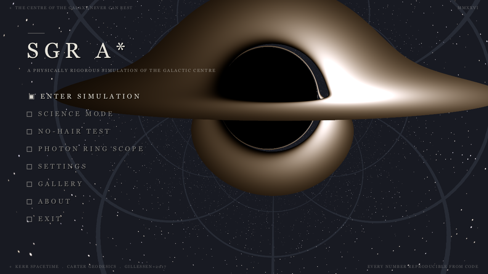
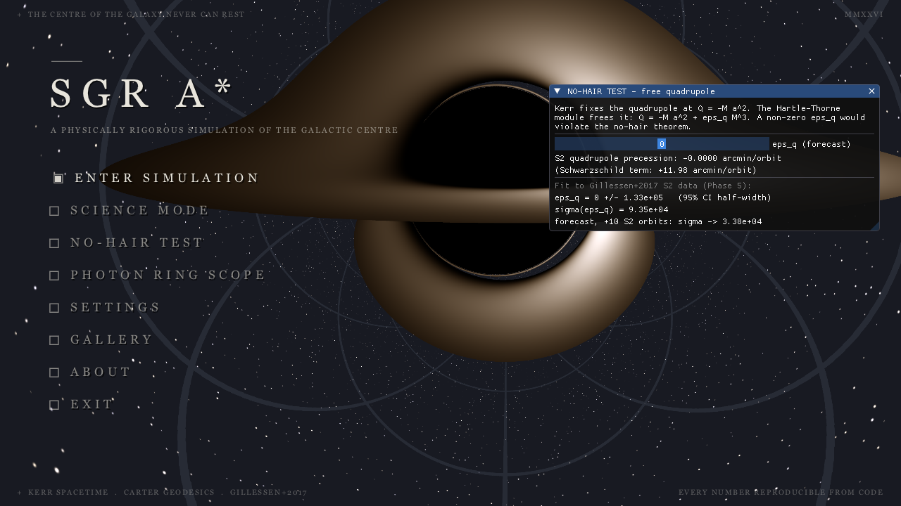
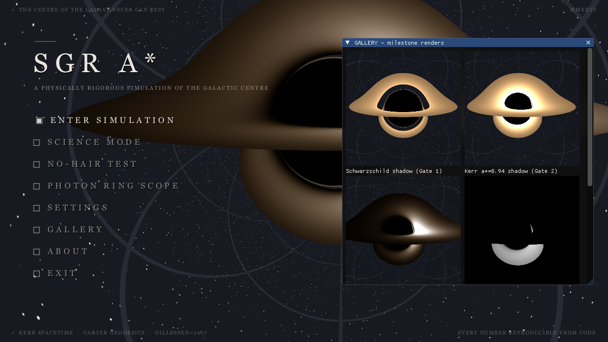
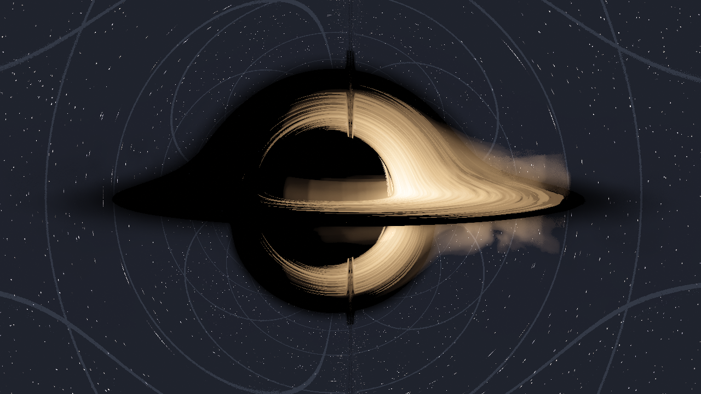
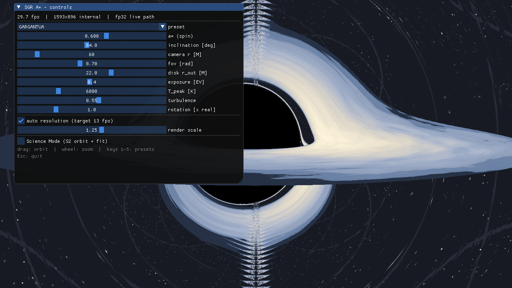
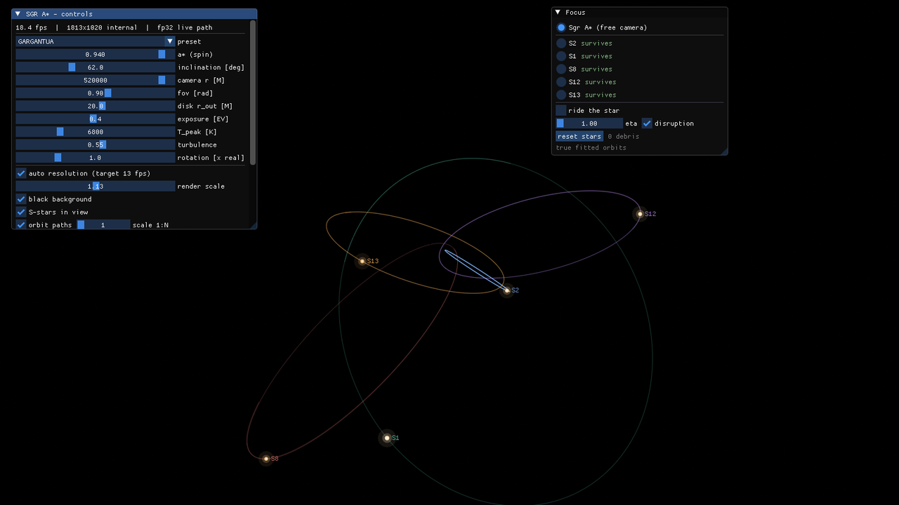
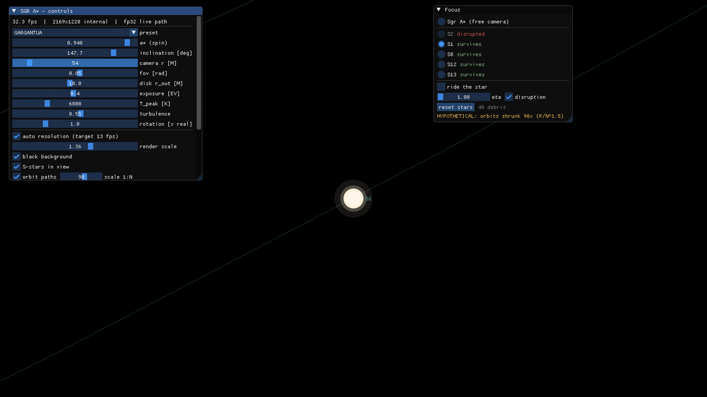

<div align="center">

# 🌌 SGR A* — Scientific Simulator

### *Welcome to the centre of the galaxy.*

**A first-principles, physically rigorous simulation of Sagittarius A\*, the
supermassive black hole at the heart of the Milky Way — from exact Kerr
geodesics to a reproducible research paper.**




*The main menu. The backdrop is not artwork — it is 8.3 million exact Kerr
geodesics (one per 4K pixel) traced by this code in the CINEMATIC SGR A\*
preset, whose warm dust banks are a display layer composited over the
unchanged physics.*

<br>

**[▶ Quick start](#-quick-start)** ·
**[🕳 What is this?](#-what-is-this)** ·
**[🎛 The modes](#-the-modes)** ·
**[🔬 The science](#-the-science)** ·
**[📕 The thesis](#-the-thesis)** ·
**[📄 The paper](#-the-research-paper)**

</div>

---

## 🕳 What is this?

This project simulates **Sagittarius A\*** from the ground up — no
post-Newtonian shortcuts, no faked visuals. It integrates the exact
Carter-separated geodesic equations in Kerr spacetime, renders the accretion
disk with the Novikov–Thorne model, **fits the real orbit of the star S2**
(145 astrometric + 44 radial-velocity measurements from Gillessen et al.
2017), and probes the **no-hair theorem** with a free-quadrupole
Hartle–Thorne metric. A validated GPU port of the same equations drives a
live, interactive renderer.

Everything it claims, it can prove: every number in the research paper is
regenerated from source by one command.

### Headline results

| Result | This code | Published |
|---|---|---|
| Black-hole mass from S2 | **4.270 ± 0.195 ×10⁶ M☉** | 4.297 ± 0.012 (GRAVITY 2022) |
| Distance to Sgr A* | **8272 ± 182 pc** | 8277 ± 9 pc (GRAVITY 2022) |
| Photon-ring diameter | **49.68 μas** | 51.8 ± 2.3 μas (EHT 2022) |
| S2 redshift excess at pericentre | **205 km/s @ 2018.379** | ≈200 km/s (GRAVITY 2018) |
| Schwarzschild precession | **11.98 arcmin/orbit** | confirmed (GRAVITY 2020) |
| No-hair quadrupole deviation | **ε_q = 0 ± 1.33×10⁵ (95%)** | — consistent with Kerr |

---

## ▶ Quick start

**Double-click `LAUNCH.bat`.** That's it — it prepares the Vulkan layer
path, builds the engine automatically the first time (one-off; vcpkg
compiles the dependencies), and boots into the cinematic menu. Arguments
pass through: `LAUNCH.bat --validation`, `LAUNCH.bat --preset 3`, …

<details>
<summary><b>Manual build & requirements</b></summary>

Requirements: Windows 10/11, a Vulkan 1.2 GPU, VS 2022 Build Tools,
vcpkg at `C:\vcpkg`, CMake 3.25+ (Ninja comes via vcpkg), Python 3.11 +
matplotlib. TinyTeX and GNU make only for the paper.

```bat
:: physics core + validation tools
scripts\vcenv.cmd cmake --preset core-rel
scripts\vcenv.cmd cmake --build --preset core-rel

:: + science modules (Ceres S2 orbit fitter)
scripts\vcenv.cmd cmake --preset sci-rel
scripts\vcenv.cmd cmake --build --preset sci-rel

:: + the Vulkan engine (the interactive app)
scripts\vcenv.cmd cmake --preset engine-rel
scripts\vcenv.cmd cmake --build --preset engine-rel

:: run the physics test suite (all 32 tests)
scripts\vcenv.cmd ctest --preset sci-rel

:: start the app
build\engine-rel\engine\sgr_engine.exe
```

To enable Vulkan validation layers: `set VK_LAYER_PATH=C:\vcpkg\installed\x64-windows\bin`
and add `--validation` (exit code = error count; the gates require zero).

</details>

---

## 🎛 The modes

Navigate the menu with **↑/↓ + Enter** or the mouse. In the simulation:

- **drag** to orbit the black hole in 3D — full 360° azimuth and inclination,
  above *and* below the disk plane
- **scroll** to zoom (camera radius 15–400 M)
- keys **1–5** switch presets, **Esc** returns to the menu
- the **turbulence** slider adds a filament layer sheared by the real
  Keplerian differential rotation — display-only, mean-1 on the
  Page–Thorne flux, so the g⁴ Doppler physics is untouched (set it to 0,
  or use the PHYSICAL preset, for the exact analytic disk)
- the **rotation [× real]** slider animates the filaments at multiples of
  real Sgr A* wall-clock time. At 1.0 (the default) the innermost orbit
  takes ~8.5 minutes — a 4-million-solar-mass black hole genuinely looks
  almost frozen. Push it to a few hundred to watch the differential shear
  wind the filaments into trailing spirals
- **auto resolution** (on by default) adjusts the internal render scale to
  hold ~13 fps at any window size; the **render scale** slider overrides it
  manually (0.25×–2×; above 1× = supersampled anti-aliasing)
- **black background** hides the starfield for a fully black backdrop —
  display only, the lensed disk is untouched
- **S-stars in view** draws S2, S1, S8, S12 and S13 orbiting *in the scene*,
  on their fitted full-GR geodesics, each a glowing ball coloured by its
  line-of-sight redshift. They project through the same camera as the ray
  tracer, so mouse orbit/zoom just works. **At true scale by default** —
  the renderer is already in real geometric units, so S2 really is 23 800 M
  out (≈1050 AU) against a ~20 M disk; press **fly out** to send the camera
  past the cluster (~5×10⁵ M) and see the real proportions, with the hole
  correctly shrinking to a lensed dot. The `scale 1:N` slider optionally
  pulls the orbits inward by a labelled factor for a close-up overview and
  genuinely re-integrates the orbit (`a → a/N`), so the period follows
  Kepler III and the star races round a precessing rosette — every such
  state is labelled *hypothetical*. **orbit paths** toggles the ellipses off
  to watch the stars alone
- the **Focus** window lists Sgr A\* and every star: click one and the camera
  locks onto it — **orbit** it with drag/scroll, or tick **ride the star** to
  sit on it and look back at Sgr A\*
- **tidal disruption ("Roche limit")**: each star carries the spectroscopic
  mass and surface gravity of [Habibi et al. 2017](data/habibi_2017/), from
  which its radius and tidal radius `r_t = η R★(M_BH/M★)^⅓` follow. Shrink the
  orbits past that and the star stretches as `(r_t/r)³` and breaks up into a
  bound debris stream (frozen-in energy spread, Rees 1988), each fragment an
  ordinary GR orbit. The thresholds are per-star predictions — S2 at N≈72,
  S8 at 96, S12 at 182 — and the simulator reproduces them

| Menu item | What it does |
|---|---|
| **ENTER SIMULATION** | Live GPU Kerr renderer. Sliders for spin a\*, inclination, camera radius, field of view, disk size, exposure, disk temperature — all live. |
| **SCIENCE MODE** | Live renderer + the fitted S2 orbit plotted over the real Gillessen+2017 astrometry, with the fit summary (M, R₀, χ²/dof) — plus a **3D S-star orbit theatre**: S2, S1, S8, S12 and S13 animated along their integrated full-GR geodesics at the joint cluster fit, each star a glowing ball coloured by its exact line-of-sight redshift (white = approaching → gold → bronze = receding). Drag to rotate, wheel to zoom, double-click for the view from Earth; time slider up to 10⁸× real. |
| **NO-HAIR TEST** | The Hartle–Thorne quadrupole slider ε_q: predicted extra S2 precession live, beside the 95% confidence interval fitted from the data. |
| **PHOTON RING SCOPE** | Measured photon sub-ring flux ratios (n=0/1/2) + a live narrow-field camera that isolates the n=1 ring at the shadow edge. |
| **SETTINGS** | The controls window, from the menu. |
| **GALLERY** | Thumbnails of the milestone renders from every validation gate. |
| **ABOUT** | Sgr A* fact panel — mass, distance, spin, shadow size, S2 period, with sources — beside the rendered black hole. |
| **EXIT** | Quit. |

<div align="center">


</div>

### Visual presets — the physics never changes, only palette and framing

| Key | Preset | Look |
|---|---|---|
| 1 | **PHYSICAL** | True blackbody colours from the Planck spectrum (default) |
| 2 | **FIRESTORM** | Deep crimson → orange → yellow-white, a\*=0.94 |
| 3 | **GARGANTUA** | Ice blue → pale gold — the *Interstellar* look, a\*=0.60 |
| 4 | **ARCTIC** | Pale cyan → electric white, a\*=0.97, 12 000 K disk |
| 5 | **NEBULA** | Violet → magenta → rose-gold, a\*=0.35, wide disk |
| 6 | **CINEMATIC SGR A\*** | Volumetric orbiting dust banks over the exact geodesics — warm *Interstellar* white-gold; the `turbulence` slider sets cloud density |

<div align="center">


</div>

<div align="center">

*Left: **CINEMATIC SGR A\***, orbiting dust banks advected by the exact Ω(r).
Right: **GARGANTUA**. The geometry is identical — only the display layer differs.*

</div>

### The S-star cluster, live

<div align="center">


</div>

<div align="center">

*Left: the five fitted stars at **true scale** — S2's orbit really is ~24 000 M
across, so the camera has flown out to 5×10⁵ M and the hole is a lensed dot.
Right: shrink the orbits past a star's tidal radius and it breaks up into a
bound debris stream — S2 goes at N≈72, S8 at 96, exactly as the cited
spectroscopy predicts.*

</div>

<details>
<summary><b>Command-line flags</b></summary>

```
--menu                boot to menu (default when run with no arguments)
--shader disk --hud   skip the menu, go straight to the live renderer
--science             open the Science window at startup
--preset N            start with preset N (0–5)
--panel NAME          open a menu panel at boot (about|nohair|scope|gallery|settings)
--astar X --incl DEG  override physics parameters
--width W --height H  window size          --scale S   render-resolution knob
--frames N            exit after N frames  --screenshot out.png
--no-mouse            disable orbit/zoom input (repeatable screenshots)
--rot X               disk rotation speed in multiples of real time
--rout R              disk outer radius [M]   --turb X   turbulence/cloud density 0–1
--blacksky            start with the starfield hidden (fully black background)
--stars               draw the S-stars orbiting in the live scene
--nopaths             ... without their orbit ellipses
--starscale N         shrink the orbits by N (1 = true distance, default)
--focus NAME          lock the camera to a star (e.g. --focus S2)
--ride                ... riding it, looking back at Sgr A*
--validation          Vulkan validation layers ON (exit code = error count)
```

</details>

---

## 🔬 The science

The physics core is a CPU reference implementation held to numerical
standards set by analytic theory — conserved quantities to 10⁻⁶, the
Schwarzschild shadow to 5×10⁻¹⁶ of Synge's formula, the Kerr shadow on
Bardeen's critical curve — and the GPU is validated against it pixel by
pixel. The command-line instruments (in `build\sci-rel\...`):

| Tool | Purpose |
|---|---|
| `validation\render_reference.exe` | CPU reference renders + shadow metrology JSON |
| `science\subring_tool.exe` | Disk render, Doppler beaming, photon sub-ring isolation |
| `science\orbit_fitter\fit_s2_tool.exe` | The S2 orbit fit — `kerr` or `nohair` (free ε_q) mode |
| `validation\sweep_tool.exe` | Sgr A* ring calibration / 20×20 spin–inclination sweep |
| `validation\render_hero.exe` | Bake the 4K menu hero plate with the CPU tracer |

---

## 📕 The thesis

**[`paper/thesis.pdf`](paper/thesis.pdf) — 203 pages, the full report.** The
same physics as the paper below, but at length and from the ground up: it
opens with six primer chapters that assume no relativity background, then
derives everything used by the code, and ends with the engineering and
validation record.

| Part | Chapters | What's in it |
|---|---|---|
| **I — Foundations for the non-specialist** | 6 primers | Gravity, spacetime, spin & the shadow, light & colour, orbits, and the numerical toolkit — written so the rest is readable without a GR course |
| **II — Theory and methods** | 1–4 | Kerr geometry, Carter-separated geodesics, and the numerical machinery (RK45, turning points, constraint projection) |
| **III — Results** | 5–11 | Shadow metrology, the Novikov–Thorne disk, photon sub-rings, the S2 forward model, the orbit fit, the 5-star cluster fit, and the no-hair ε_q limit |
| **IV — Engineering & validation** | 12–17 | The GPU port and its pixel-level cross-check, Sgr A\* calibration, the interactive instrument, the **development history with its ten bug hunts**, discussion, conclusions |
| **Appendices** | A–E | Algebra, pseudocode, number provenance, the reproduction pipeline, and a notation glossary |

Two things make it more than a write-up. Every quantity in the text is a
LaTeX macro generated from simulation JSON, so the prose cannot drift from
the code. And Chapter 15 documents the failures honestly — the
tolerance-dependent shadow, the quadrupole sign error, the vanishing mass
uncertainty, the render artefacts and the regressions the first fixes caused
— because what a validation system *caught* is the best evidence for what it
would catch.

```bash
make thesis      # figures + compile paper/thesis.pdf (pdflatex ×2 + bibtex)
```

---

## 📄 The research paper

**[`paper/main.pdf`](paper/main.pdf)** — an 11-page, MNRAS-style research
paper covering the full theory, the numerical methods, and all results, with
three appendices (verification gates, reproduction pipeline, number
provenance). The condensed, journal-shaped version of the thesis above.

```bash
make figures     # regenerate all 10 paper figures from simulation output
make paper       # figures + compile paper/main.pdf (pdflatex + bibtex)
make reproduce   # re-run the ENTIRE science chain: tests → renders →
                 # sub-rings → S2 fits → calibration + sweep → figures
```

Every number in both documents is a LaTeX macro generated from the
simulation's JSON artefacts — nothing is typed by hand, so they cannot
silently drift from the code. The final verification run regenerated **all 92
macros bit-identically**.

---

## 🗺 Repository map

```
physics/     Kerr metric, Carter geodesics (Mino-time 2nd order), disk model,
             CPU ray tracer + the Catch2 test suite (the ground truth)
science/     Ceres S2 orbit fitter, redshift model, photon sub-ring extractor
engine/      Vulkan 1.2 app: compute shaders, presets, ImGui HUD, menu
validation/  reference renders, CPU-vs-GPU comparison, calibration artefacts
data/        Gillessen et al. (2017) S2 astrometry + radial velocities (VizieR)
paper/       the thesis (thesis.pdf, 203 pp) and journal paper (main.pdf),
             their chapters/ sources + auto-generated figures and numbers
scripts/     build wrapper, figure/number generators, benchmarks, LUT baker
writeup/     per-phase evidence screenshots and the build plan
```

## 🏁 Development history

Built in 12 gated phases — no phase started while a previous gate was red,
and each passing gate is a git tag, from `v0.0-physics-foundation` to
`v1.0-paper`. The gate criteria and measured results are in Appendix A of
the paper and under `writeup/screenshots/`.

<div align="center">

*Every rendered image is defensible against published observations.*
*Every number in the paper is reproducible from the code.*

</div>
